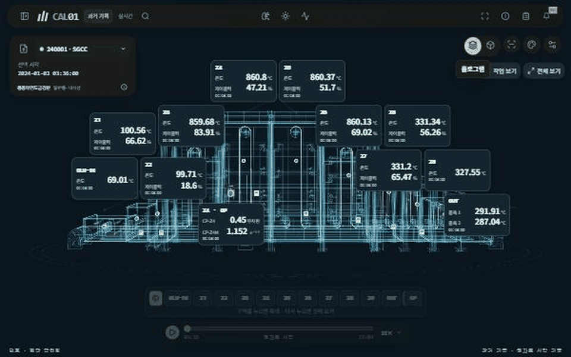

<div align="center">

<picture>
  <source media="(prefers-color-scheme: dark)" srcset="docs/readme/hero-dark.svg">
  
</picture>

[](https://cal01-monitor.onrender.com/)
[](https://github.com/posco-3bungi-pdm/pdm-project)
[](https://github.com/posco-3bungi-pdm/cal01-review)

</div>

- 연속 소둔로(CAL01)에서 기준을 벗어난 채널을 찾고 모니터링팀과 현장팀이 같은 근거로 확인·요청·조치하는 소프트웨어임
- 팀 로그인, 실제 CSV 재생, 소둔로 3D, Z-score 후보·알림·현장 요청, 구역별 예측 모델을 한 화면에 연결함
- Windows exe는 같은 서버에 접속하는 전용 앱임



## 한 건의 업무가 끝까지 가는 길

<picture>
  <source media="(prefers-color-scheme: dark)" srcset="docs/readme/flow-dark.svg">
  
</picture>

## 화면

| 화면 | 하는 일 | 여는 곳 |
| --- | --- | --- |
| 3D 설비 화면 | 연속 소둔로 11구역을 금속·홀로그램·내부 보기로 바꿔 봄. 구역을 고르면 그 채널의 계측값, 그래프, 요청 화면이 열림. 드래그 회전, 휠 확대, WASD 이동 | 첫 화면 |
| 기록 재생 | 원본 CSV를 1초 기록 그대로 재생. 재생 위치와 속도를 바꾸고 단축키로 멈춤·이동 | 아래 재생 바 |
| 채널 그래프 | 고른 채널의 시간 그래프와 Z-score ±3σ 기준선. 같은 시각의 다른 채널을 나란히 봄 | 위 도구막대 |
| 과거 LOT 이상 후보 | LOT별 3σ 후보와 팀 판단(검토 사이트에서 가져옴)을 3D 위치와 함께 봄 | 위 도구막대 |
| 팀 확인 요청함 | 같은 구간을 붙여 현장팀에 점검을 요청하고 조치와 확인을 한 건으로 모음 | 위 도구막대 |
| 팀 알림 | 요청·조치·확인이 생기면 팀원 모두에게 알림 | 종 아이콘 |
| 예측 모델 선택 | 레지스트리의 구역별 모델을 골라 재생 중인 분마다 점수를 냄. 근거 단계가 낮은 구역은 표시만 함 | 위 도구막대 |
| 가이드 | 공정과 채널을 7단계로 살펴봄 | 메뉴 |

## 구조

| 부분 | 쓴 것 | 폴더 |
| --- | --- | --- |
| 서버 | Python, Django (팀 계정, CSV 가져오기, Z-score 감지, 요청·알림 API) | `backend/` |
| 화면 | TypeScript, React, Vite, 3D (three.js) | `frontend/` |
| Windows 앱 | Electron. 같은 서버에 접속하는 전용 창 | `desktop/` |
| 모델 | pdm-project 05 노트북이 저장한 구역별 모델과 `registry.json` (`scripts/import_models.py`로 가져옴) | `models/` |
| 실시간 시연 | 2026년 하루치 CSV를 만들어 재생하는 노트북 | `simulation/` |
| 배포 | Render (Docker), PostgreSQL. `render.yaml` | 루트 |

- 원본 CSV, 비밀번호, API 키, 실행 DB는 Git에 올리지 않음

## 모델 레지스트리

- `models/registry.json`에 구역 9개(CLN, Z1 ~ Z8)의 RandomForest, IsolationForest와 Z-score 기준을 적어 둠
- 이름은 `cal01-<정답 버전>-<입력 태그>-<구역>-<모델>-<학습 범위>-<날짜>`이고 항목마다 근거 단계(팀 판단 1과 0이 있는지), 시간 순서 걷기 F1, 입력 컬럼 목록(`features.json`), 설정(`config.json`)이 붙음
- 지금은 v6 정답으로 만든 모델이며 v7 규칙이 확정되면 바꿔 넣음
- 자세한 규칙은 [04 감지와 해석 §8](docs/04-detection.md)

## 설계 문서

| 문서 | 결정하는 내용 |
| --- | --- |
| [01 제품과 화면](docs/01-product.md) | 팀별 업무, 화면, 3D 사용 흐름 |
| [02 서버 구조](docs/02-architecture.md) | 재사용할 코드, 로그인, 로컬 서버, 저장과 복구 |
| [03 데이터와 API](docs/03-data-contracts.md) | 파일·채널·판단·업무 요청을 연결하는 규칙 |
| [04 감지와 해석](docs/04-detection.md) | Z-score 기준, 알림 묶기, 시간축, 모델 레지스트리 |
| [05 4일 개발 계획](docs/05-delivery.md) | 첫 시연 범위, 개발 순서, 완료 기준 |
| [06 오픈소스와 3D](docs/06-open-source-and-3d.md) | 사용할 오픈소스, 연속 소둔로 모형 제작 |
| [07 오픈소스 비교](docs/07-open-source-selection.md) | 완성형 관제·정비 제품, 재사용할 UI·3D 부품 |
| [08 로컬 실행](docs/08-local-development.md) | 설치, 실제 자료 등록, 계정, 실행과 검증 |
| [09 Windows 앱과 감지](docs/09-windows-and-detection.md) | exe 실행, Z-score 기준, 현장 요청 흐름 |
| [10 공정 모형 출처](docs/10-process-model-sources.md), [11 재료 참고](docs/11-material-reference.md) | 3D 모형과 질감의 근거 |
| [11 공용 서버](docs/11-team-server.md) | 팀 공용 배포, 기존 DB 이전, exe 서버 연결 |

## 실행

- Python 3.12 이상, Node 22 이상, pnpm, PostgreSQL 18을 씀
- 순서는 [08 로컬 실행](docs/08-local-development.md)에 있음

```powershell
python -m venv .venv
.venv/Scripts/python.exe -m pip install -r backend/requirements.txt
pnpm --dir frontend install --frozen-lockfile
.venv/Scripts/python.exe backend/manage.py migrate
.venv/Scripts/python.exe backend/manage.py import_cal01 "원본 폴더/cal01_base_v1.csv"
```

- 검증은 `backend/manage.py test monitor`와 `pnpm --dir frontend build`로 함

## 지금 상태와 남은 것

- 돌아가는 것: 팀 로그인, 실제 CSV 재생, 3D(금속·홀로그램·내부), 채널 그래프, 과거 LOT 이상 후보, 팀 확인 요청과 알림, v6 모델 9개 선택과 분별 예측
- 남은 것: 실시간 수집 연결, 고정 기준 감지, AI 설명 초안, 달력, v7 모델 교체

- 제품 이름은 CAL01 Monitor, 저장소는 `posco-3bungi-pdm/cal01-monitor`임
- 2026년 10월 25일부터 공개 저장소임
- 만든 팀: 포스코 K-뉴딜 아카데미 3조 오운완<sub>(오늘 운전 완벽)</sub>
