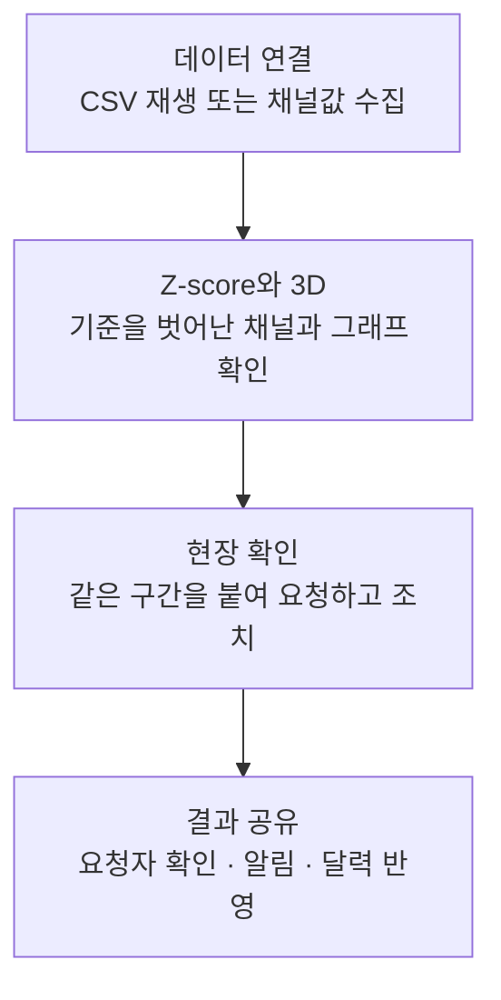

# CAL01 Monitor

소둔로에서 기준을 벗어난 채널을 찾고, 모니터링팀과 현장팀이 같은 근거로 확인·요청·조치하는 소프트웨어.

팀 로그인, 실제 CSV 조회, 소둔로 3D, Z-score 후보·알림·현장 요청을 연결함. 가이드에서 공정과 채널을 7단계로 살펴볼 수 있음. Windows exe는 같은 서버에 접속하는 전용 앱임. [로컬 실행](docs/08-local-development.md) · [Windows 앱과 감지 기준](docs/09-windows-and-detection.md).

기존 분석 자료와 공동 검토 서버의 판단은 그대로 유지함. 현재 감지는 과거 LOT 분석이며 실시간 수집·고정 기준 감지·AI 설명·달력은 후속 개발 범위임.

## 첫 시연에서 끝까지 보여줄 흐름

3D는 핵심 화면임. 채널 위치를 선택·이동·저장하고, 해당 채널의 그래프와 요청 화면을 바로 열 수 있게 함.

남은 일정은 **설계 확인을 포함한 4일**임. PPTX 모형 대신 실제 연속 소둔로 구조를 참고해 새 모형을 제작함. 2일차까지 업무 한 건을 끝내는 흐름을 연결하고, 3일차에 기본 달력·AI·핵심 모핑을 마무리함. 4일차는 검증과 수정에 사용함. 이번 구현 범위는 [4일 개발 계획](docs/05-delivery.md)을 따름.

## 설계 읽는 순서

| 문서 | 결정하는 내용 |
| --- | --- |
| [01 제품과 화면](docs/01-product.md) | 팀별 업무, 화면, 3D 사용 흐름 |
| [02 서버 구조](docs/02-architecture.md) | 재사용할 코드, 로그인, 로컬 서버, 저장과 복구 |
| [03 데이터와 API](docs/03-data-contracts.md) | 파일·채널·판단·업무 요청을 연결하는 규칙 |
| [04 감지와 해석](docs/04-detection.md) | Z-score 기준, 알림 묶기, 시간축, AI 역할 |
| [05 4일 개발 계획](docs/05-delivery.md) | 이번 시연 범위, 개발 순서, 완료 기준 |
| [06 오픈소스와 3D](docs/06-open-source-and-3d.md) | 사용할 오픈소스, 새 연속 소둔로 모형 제작 |
| [07 오픈소스 비교](docs/07-open-source-selection.md) | 완성형 관제·정비 제품, 재사용할 UI·3D 부품과 자산, 이번에 가져올 범위 |
| [08 로컬 실행](docs/08-local-development.md) | 설치, 실제 자료 등록, 계정, 실행과 검증 |
| [09 Windows 앱과 감지](docs/09-windows-and-detection.md) | exe 실행, Z-score 기준, 현장 요청 흐름 |

제품 이름은 CAL01 Monitor, 저장소는 `posco-3bungi-pdm/cal01-monitor`임. 비공개로 시작함. 원본 CSV, 비밀번호, API 키, 실행 DB는 Git에 올리지 않음.
