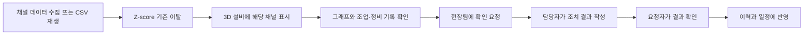

# CAL01 Monitor

소둔로에서 기준을 벗어난 채널을 찾고, 모니터링팀과 현장팀이 같은 근거로 확인·요청·조치하는 소프트웨어.

**현재는 설계 단계임. 실행하는 앱이나 서버는 아직 만들지 않았음.** 설계를 함께 확인한 뒤 개발을 시작함. 기존 분석 저장소와 공동 검토 서버는 그대로 유지함.

## 첫 시연에서 끝까지 보여줄 흐름

3D는 핵심 화면임. 채널 위치를 선택·이동·저장하고, 해당 채널의 그래프와 요청 화면을 바로 열 수 있게 함.

## 설계 읽는 순서

| 문서 | 결정하는 내용 |
| --- | --- |
| [01 제품과 화면](docs/01-product.md) | 팀별 업무, 화면, 3D 사용 흐름, 이번 주 범위 |
| [02 서버 구조](docs/02-architecture.md) | 재사용할 코드, 로그인, 로컬 서버, 저장과 복구 |
| [03 데이터와 API](docs/03-data-contracts.md) | 파일·채널·판단·업무 요청을 연결하는 규칙 |
| [04 감지와 해석](docs/04-detection.md) | Z-score 기준, 알림 묶기, 시간축, AI 역할 |
| [05 일주일 개발 계획](docs/05-delivery.md) | 개발 순서, 완료 기준, 시연 시나리오 |
| [06 오픈소스와 3D](docs/06-open-source-and-3d.md) | 사용할 오픈소스, 기존 설비 모형 검토 |

제품 이름은 CAL01 Monitor, 저장소는 `posco-3bungi-pdm/cal01-monitor`임. 비공개로 시작함. 원본 CSV, 비밀번호, API 키, 실행 DB는 Git에 올리지 않음.
