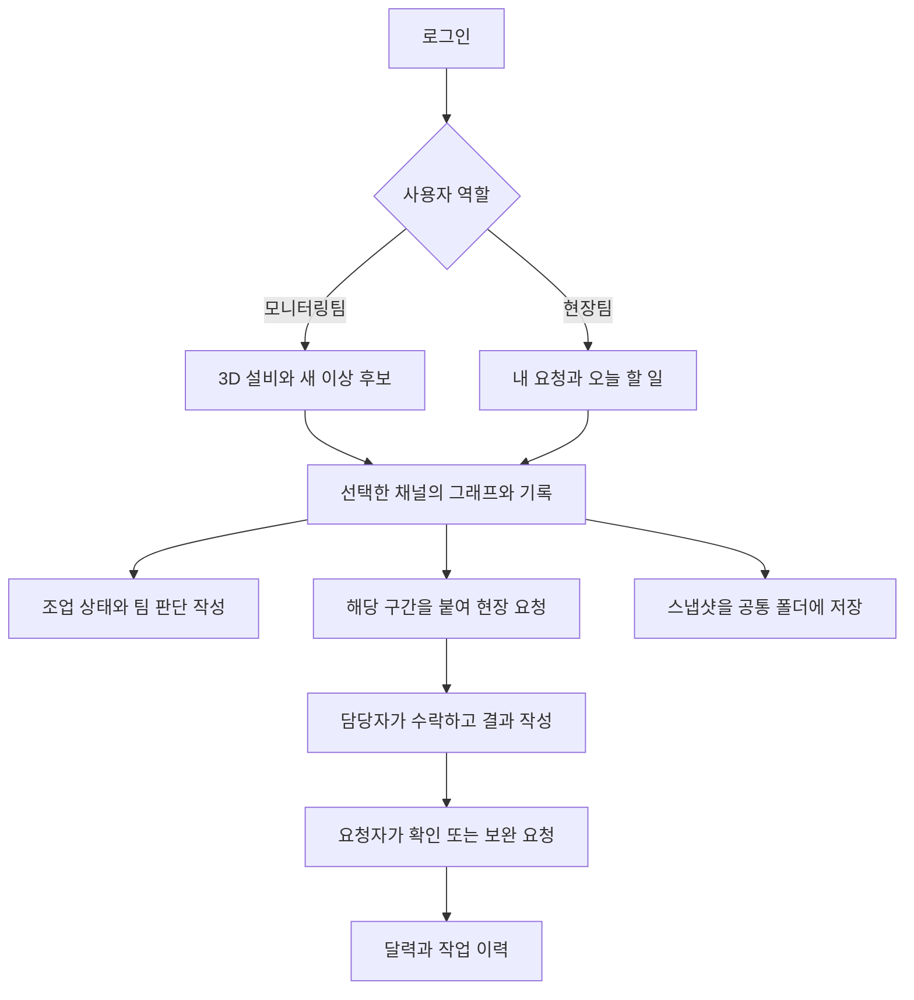
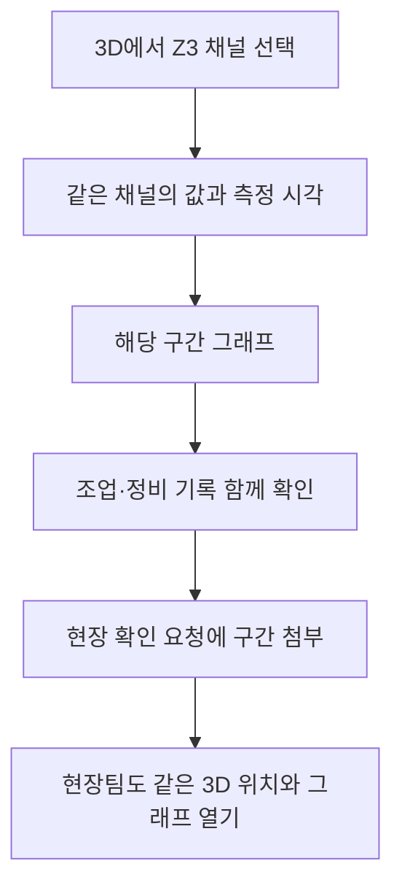
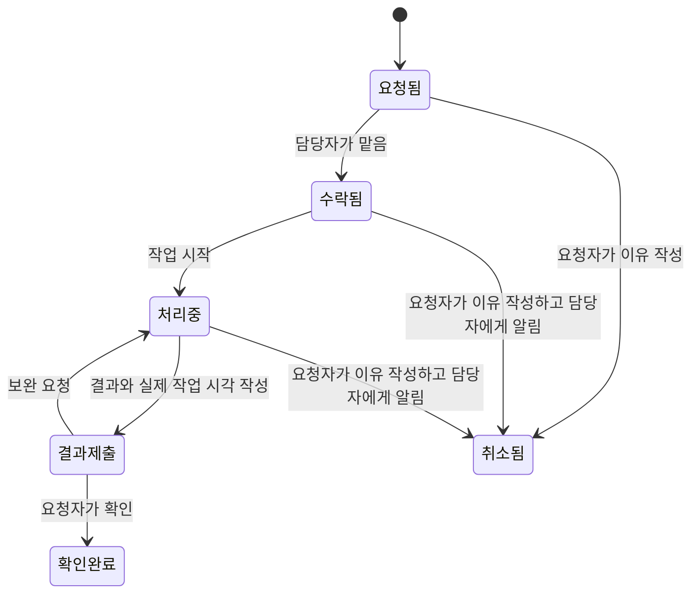

# 제품과 화면 설계

이 소프트웨어의 목적은 **기준을 벗어난 값을 발견한 뒤, 누가 확인하고 무엇을 조치했는지까지 이어서 남기는 것**임. 그래프, 3D, 알림, 업무 요청은 모두 같은 채널과 같은 구간을 가리켜야 함.

아래는 구현 전 설계안임. 역할 구분과 3D의 필수 포함은 사용자 요청이고, 화면 구성과 세부 동작은 이번 설계에서 제안함.

## 1. 누가 무엇을 보는가

| 역할 | 팀원 | 로그인 후 먼저 보는 것 | 할 수 있는 일 |
| --- | --- | --- | --- |
| 모니터링팀 | 수진, 태구 | 3D 설비 상태, 새 이상 후보, 답변을 기다리는 요청 | 구간 확인, 팀 판단 작성, 현장 요청, 결과 확인 |
| 현장팀 | 유진, 정렬, 민호 | 나에게 온 요청, 오늘 할 일, 관련 설비 | 요청 수락, 담당자 협의, 현장 메모·사진, 조치 결과 작성, 다른 팀에 확인 요청 |
| 시스템 관리자 | 별도 지정 | 계정, 채널 연결, 데이터 등록, 감지 기준 | 계정·권한·데이터 소스·모형 버전 관리 |

모니터링팀이라는 이유로 시스템 관리자 권한까지 주지 않음. 모두 같은 설비와 근거를 볼 수 있고, 수정 가능한 업무만 역할과 담당자에 따라 구분함. 사용자가 화면에서 역할을 골라 권한을 바꿀 수는 없음.

## 2. 화면은 여섯 곳으로 모음

| 메뉴 | 화면에 보이는 내용 | 다음 행동 |
| --- | --- | --- |
| 설비 보기 | 3D 소둔로, 채널 위치, 마지막 수집 시각, 기준 이탈 상태 | 채널 선택 → 그래프 열기 |
| 구간 확인 | 채널 그래프, 기준선, 노란 선택 구간, LABEL, 앞뒤 조업·정비 기록 | 판단 저장 또는 현장 요청 |
| 요청과 할 일 | 요청함, 내가 맡은 일, 기한, 진행 상태 | 수락 → 조치 → 결과 보내기 |
| 달력과 연간 흐름 | 월별 계획·실제 작업·할 일, 연간 관측과 기준 이탈 | 날짜 선택 → 그날 기록과 그래프 |
| 팀이 남긴 구간 | 공통 폴더, 순서, 스냅샷, 작성자·변경 이력 | 같은 구간 열기 또는 요청에 첨부 |
| 관리 | 계정, 데이터 등록, 채널 정보, 기준 버전, 3D 위치 편집 | 설정 검토 후 저장 |

상단에는 **과거 자료 보기 / CSV 재생 / 실시간 수집** 중 현재 모드를 항상 표시함. 실시간 연결이 없는데 실시간처럼 표시하지 않음.

## 3. 3D는 장식이 아니라 첫 진입 화면

설비 전체를 본 뒤 존을 선택하면 그 존의 채널 표시점이 강조됨. 표시점을 누르면 채널명, 값, 단위, 측정 시각, 기준 이탈 상태와 **그래프 열기** 버튼을 보여줌. 그래프에서 선택한 채널은 3D에서도 같은 표시점을 강조함.

- 표시점의 위치는 **설비 모형 버전 + 채널 ID + 모형 내부 좌표**로 저장함. 화면 픽셀 좌표로 저장하지 않음.
- 위치 편집은 별도 모드로 들어감. 존 선택 → 표면에 표시점 놓기 → 이동 → 미리보기 → 저장 순서임. 취소하면 이전 위치를 유지함.
- 저장 전 변경점, 저장한 사람, 변경 시각을 남김. 모형을 바꿔도 이전 좌표를 새 모형에 조용히 덮어쓰지 않음. 새 모형의 위치 대응을 확인해야 함.
- 한 채널에 여러 위치가 필요한 경우를 첫 주에 복잡하게 구현하지 않음. 첫 버전은 채널당 활성 위치 하나로 시작함.
- 현재값이 없는 채널은 회색과 `새 값 없음` 문구로 표시함. 오래된 값을 최신값처럼 보이지 않게 함.
- 과거 보기는 사용자가 고른 시각, CSV 재생은 현재 재생 시각을 기준으로 값을 찾음. 선택 시각보다 뒤의 값을 가져오지 않음. 실시간만 현재 수집 시각을 기준으로 지연을 계산함. 2024년 자료라는 이유만으로 과거 보기의 모든 표시점을 회색으로 만들지 않음.
- 범위를 벗어나면 주황색과 `기준 이탈`을 표시함. 팀이 확인한 이상은 별도 배지로 표시함. 색만으로 뜻을 전달하지 않음.
- 라이트·다크에서 같은 의미의 색을 씀. 장식용 상시 회전이나 강한 점멸은 넣지 않음. 모델은 사용자가 돌리고 확대함.
- 3D를 지원하지 않는 브라우저에는 채널 목록으로 같은 업무를 할 수 있게 함. 단, 목표 시연 PC에서 3D가 동작해야 완료임.

기존 GLB 설비 모형을 먼저 검토함. 형상·출처·용량·존 구분을 확인한 뒤 활용함. **실제 센서 설치 위치를 실측한 자료가 없으면 화면에 배치한 위치는 팀이 설정한 위치임.** 강판의 실제 이동 추적이나 공정 제어 기능으로 소개하지 않음.

## 4. 그래프를 읽다가 설명을 다시 해석하지 않게 함

선택한 구간을 계속 **노란 구간**이라고 부름. `노란 구간 확대`, `노란 구간을 요청에 첨부`처럼 앞에서 본 표시와 다음 행동을 연결함. `센서 선택` 대신 **채널 선택**을 사용함. 물리적인 부착 위치를 설명할 때만 센서라는 말을 씀.

그래프의 기본 시간축은 자료에 기록된 날짜·시각임. LOT 시작 후 경과시간은 추가 보기로 제공하고 축에 단위를 명시함. 설명의 `13:26`은 그래프의 같은 시각에 표시점을 넣고 `2024-01-02 13:26`처럼 날짜까지 함께 확인할 수 있어야 함.

- 채널 전체 / TC / OP 선택과 개별 선택을 제공함.
- 선택 구간 확대·축소, 좌우 범위 늘리기, 같은 시각 정렬은 유지함.
- Z3→Z6 순차 창 보기는 **사용자가 정한 시간 차이로 비교**하는 기능으로 유지함. 실제 강판 위치를 계산한 결과로 표시하지 않음.
- LABEL=1은 보라색 띠, 사용자의 선택은 노란색, Z-score 기준 이탈은 주황색으로 구별함.
- 조업·정비 기록은 앞뒤 며칠까지 따로 늘려 봄. 기록 범위를 늘렸다고 채널 그래프의 확대가 풀리지 않음.
- 스냅샷에는 채널·날짜·구간·모드·데이터 버전·기준 버전이 같이 저장됨. 다른 사람이 눌러도 같은 자료를 엶.

### 산업 현장 화면과 모핑

모니터링팀의 첫 화면은 **3D 설비 + 새 이상 후보 + 답변을 기다리는 요청**으로 구성함. 현장팀은 **받은 요청 + 내가 맡은 작업 + 오늘 할 일**을 먼저 봄. 현장팀이 요청을 누르면 관련 3D 위치와 그래프가 함께 열림. 두 화면은 같은 데이터를 읽고, 계정의 역할에 맞는 업무를 앞에 배치함.

상단에는 설비, 데이터 모드, 측정 시각, 연결 상태, 로그인한 팀을 고정해서 표시함. 설비·시간축은 같은 위치에 유지하고, 밝기 차이와 얇은 구분선으로 영역을 나눔. 금속 표면과 은은한 그라데이션은 설비의 깊이를 보여주는 데 사용함. 기준 이탈·선택 구간·작업 상태의 색에는 각각 이름을 붙임.

**모핑은 방금 보던 대상이 다음 화면의 어디로 이어지는지 보여주는 기능으로 넣음.**

| 동작 | 화면에서 이어지는 움직임 |
| --- | --- |
| 설비 전체에서 Z3 선택 | 같은 모형을 유지하고 카메라가 Z3 쪽으로 이동함. 선택한 채널 표시점은 계속 보임. |
| 채널 표시점 선택 | 채널 이름이 붙은 상세 영역이 펼쳐지고 같은 채널 그래프가 나타남. |
| 노란 구간 확대 | 원래 시간축에서 선택한 범위로 부드럽게 확대함. 시작·끝 시각과 노란 경계가 함께 이동함. |
| 노란 구간으로 현장 요청 | 선택한 채널·구간이 요청 작성 화면의 첨부 구간으로 이어짐. 입력 내용은 유지함. |
| 현장 요청의 알림 선택 | 해당 요청이 열리고 같은 설비 위치·구간으로 이동함. |
| 결과 제출·확인 완료 | 서버 저장 성공 후 같은 요청의 상태와 목록 위치가 바뀜. 실패하면 입력을 남겨 다시 저장할 수 있게 함. |
| 스냅샷 순서 변경 | 잡은 항목의 이동에 맞춰 주변 항목이 자리를 바꿈. 공통 순서는 서버 저장 후 확정함. |

시작 설정은 패널 전환 180~280ms, 3D 카메라 이동 400~650ms로 제안함. 실제 발표용 PC에서 확인해 조정함. 새 대상을 선택하거나 사용자가 카메라를 움직이면 진행 중인 전환을 중단하고 새 조작을 따름. 애니메이션이 끝날 때까지 알림이나 버튼을 막지 않음.

측정 숫자와 감지 상태는 실제 응답값으로 갱신함. 숫자를 부드럽게 바꾸려고 존재하지 않는 중간 측정값을 표시하지 않음. 그래프 확대는 시간축을 움직이되 관측 공백을 채우지 않음. 운영체제의 움직임 줄이기 설정과 앱의 움직임 설정을 제공함.

화면 영역과 요청 항목의 모핑은 Motion for React, 3D 카메라 이동은 Three.js·Drei를 사용함. 측정 그래프는 시간축과 표시점 좌표를 직접 갱신해 축과 선이 따로 움직이지 않게 함. PPTX의 모형을 재사용해도 발표용 Morph 전환 자체는 웹에서 다시 구성함. [Motion의 화면 전환](https://motion.dev/docs/react-layout-animations), [Drei의 카메라 이동](https://drei.docs.pmnd.rs/staging/bounds)

## 5. 현장과의 소통은 요청 한 건에 모음

요청에 **어디를 / 왜 / 언제까지 / 누구에게 / 무엇을 확인해 달라는지**를 남김. 그래프와 기록을 다시 찾아 설명하지 않도록 같은 구간을 자동 첨부함. 제목만 적은 일반 채팅으로 흩어지지 않게 함.

필수 내용은 설비·채널, 구간, 요청 내용, 받는 팀임. 담당자와 기한은 모를 때 비워둘 수 있고, 비워둔 항목을 명확히 표시함. 예상 원인을 사실처럼 채워 넣지 않음.

수락할 때는 한 명만 담당자로 저장되어야 함. 두 사람이 동시에 수락하면 나중 요청에 현재 담당자를 보여줌. 담당 변경, 기한 변경, 결과 수정은 이력을 남기고 관련자에게 알림을 생성함. 담당자의 결과 제출과 요청자의 확인 완료를 구분함. 요청자는 모니터링팀과 현장팀 모두 가능함.

서버 상태값과 화면 문구는 [데이터 계약](03-data-contracts.md)의 표로 고정함. 팀 판단을 확정하는 권한도 별도로 둠. 기본안은 모니터링팀의 지정된 검토 담당자가 확인한 근거를 정리해 확정하고, 현장팀은 관찰·조치 근거를 추가하는 방식임. 단순 의견 작성은 확정 상태를 바꾸지 않음.

## 6. 알림과 달력의 의미

알림은 새 기준 이탈, 나에게 온 요청, 담당 변경, 결과 제출, 보완 요청, 스냅샷·판단 수정에 사용함. 같은 구간의 매 측정값마다 새 알림을 만들지 않음. 화면이 열려 있을 때 약 2초 간격으로 새 항목을 가져오고, 다시 로그인하면 읽지 않은 알림을 복원함. 첫 주에는 브라우저를 닫은 상태의 문자·모바일 푸시까지 약속하지 않음.

월 달력은 **예정 작업 / 실제 작업 / 할 일**을 구분함. 정기수리 계획이 있다고 실제 정비 완료로 표시하지 않음. 연간 화면은 관측 시간, 기준 이탈 구간, 팀이 확인한 이상을 따로 보여줌. 자료가 없는 날은 `관측 없음`임.

## 7. 첫 주의 경계

**반드시 완성:** 계정별 로그인, 3D 채널 선택·위치 저장, 실제 CSV 등록·재생, Z-score 후보, 같은 구간 확인, 팀 판단, 현장 요청·결과, 저장되는 알림, 월·연간 화면, Claude 설명 초안, 기존 검토 기능의 핵심 흐름.

**연결 형식까지 준비:** 외부 수집 프로그램이 보내는 HTTP 데이터. 실제 PLC/OPC UA/MQTT 연결은 장비 주소·권한·채널 규격을 받은 뒤 별도 검증함.

**이번 주 제외:** 설비 자동 제어, 실제 강판 추적, 범용 CAD 편집기, 신규 고장 예측 모델 학습, 별도 모바일 앱, 전사 메신저, 인터넷 공개 운영. 기존 팀 판단과 LABEL을 자동 정답으로 바꾸는 기능도 넣지 않음.
