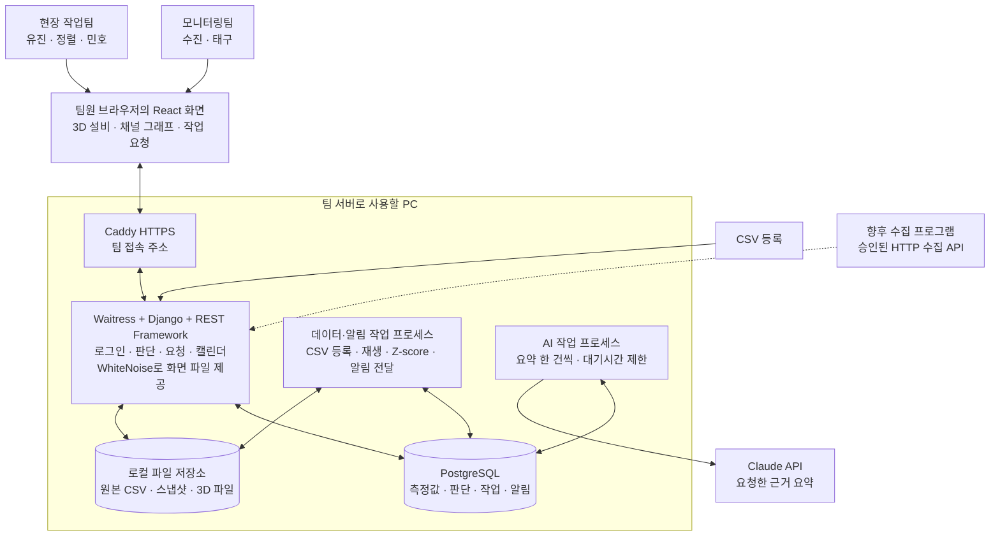

# 서버와 화면을 어떻게 연결할지

> 개발 전 설계안. 아래 기능은 아직 구현하지 않았음. 전체 구조 중 4일에 구현할 범위는 [개발 계획](05-delivery.md)을 따름. 범용 업로드와 기존 서버의 전체 이전은 후속 범위이며, 이번 시연은 서버의 지정된 CSV를 등록해 사용함.

## 1. 한 서버에서 시작

**Django + React + PostgreSQL로 만들 예정.** Python으로 데이터 처리를 이어가고, 로그인·권한·관리 화면은 Django에 있는 기능을 사용함. 기존 대시보드의 시간축과 구간 선택 화면은 가져오되, Cloudflare에 묶인 저장 코드는 가져오지 않음.



| 부분 | 선택 | 이유 |
|---|---|---|
| 서버 | Django 5.2 LTS + Django REST Framework | 사용자·그룹·권한·세션·관리 화면·DB 변경 관리 기능을 활용함. |
| 화면 | React + TypeScript + Vite | 기존 그래프와 구간 선택 코드를 재사용함. 배포할 때 정적 파일로 빌드함. |
| 저장 | PostgreSQL | 측정값을 넣는 중에도 팀원이 판단과 작업 결과를 저장해야 함. |
| 데이터·알림 작업 | 같은 Python 코드의 작업 프로세스 | CSV를 작은 묶음으로 처리하고 그 사이 새 알림을 전달함. |
| AI 작업 | 같은 Python 코드의 별도 작업 프로세스 | Claude 응답을 기다리는 동안 데이터 처리와 알림이 멈추지 않게 함. 한 번에 한 건만 실행함. |
| 알림 전달 | 2초마다 새 알림 조회 | 다섯 명이 사용할 첫 버전에서는 별도 메시지 서버 없이 검증하기 쉬움. |
| 파일 | 서버 PC의 지정 폴더 | 원본 CSV와 이미지, 3D 파일을 DB와 분리해서 보관함. |

Django 5.2 LTS는 2028년 4월까지 지원되는 계열임. 실제 개발을 시작할 때 지원 중인 패치 버전을 고정함. [Django 지원 버전](https://www.djangoproject.com/download/)

SQLite를 다섯 명이 쓸 수 없다는 뜻은 아님. 이번에는 데이터 수집과 판단 저장이 동시에 일어나므로 PostgreSQL로 시작해 중간에 DB를 바꾸는 일을 줄이려는 선택임. [Django의 SQLite 동시 접근 설명](https://docs.djangoproject.com/en/5.2/ref/databases/#database-is-locked-errors)

Redis·Kafka·Celery·별도 마이크로서비스는 첫 버전에 넣지 않음. 처리량이 부족하다는 측정 결과가 생겼을 때 다시 판단함.

핵심 실행 단위는 웹/API, PostgreSQL, 데이터·알림 작업자, AI 작업자 네 개임. React는 빌드한 정적 파일로 제공하므로 팀 시연용 별도 Node 개발 서버를 계속 켜두지 않음.

## 2. 로그인 후 무엇이 달라지는지

로그인 화면은 하나임. 로그인한 계정의 팀에 따라 첫 화면과 할 수 있는 일이 달라짐. **버튼을 숨기는 데서 끝내지 않고, 서버에서도 권한을 검사함.**

| 일 | 모니터링팀 | 현장 작업팀 | 운영 관리자 |
|---|---|---|---|
| 채널·기록·판단 보기 | 가능 | 가능 | 가능 |
| 관찰 내용·의견 남기기 | 가능 | 가능 | 가능 |
| 현장 확인 요청 보내기 | 가능 | 가능 | 가능 |
| 요청 수락·작업 시작·결과 작성 | 담당자일 때 | 담당자일 때 | 담당자일 때 |
| 요청 결과 확인·다시 요청 | 요청자 | 요청자 | 대리 처리 시 이유 기록 |
| Z-score 기준 활성화 | 지정된 담당자 | 조회 | 권한 지정 |
| 3D 설비·채널 위치 보기 | 가능 | 가능 | 가능 |
| 3D 채널 위치 수정 | 지정된 담당자 | 지정된 담당자 | 권한 지정 |
| 계정·팀·수집원 설정 | 불가 | 불가 | 가능 |

- 수진·태구는 모니터링팀, 유진·정렬·민호는 현장 작업팀으로 시작함.
- 운영 관리자는 로그인 계정과 설정을 관리하는 권한임. 팀 역할과 별도로 지정함. 누가 맡을지는 설치 전에 정함.
- 현장 요청을 보내는 사람이 담당팀을 선택함. 팀에서 한 명이 수락하면 담당자로 기록함.
- 의견 작성과 팀 판단 확정을 구분함. 팀 판단을 확정할 담당자와 확정 절차는 개발 착수 전 범위 문서에서 정함.
- 기존 스냅샷처럼 자신의 글을 수정할 수 있게 하고, 이전 내용과 수정자를 함께 보관함. 다른 사람의 글을 고쳐서 자신의 판단으로 만들 수 없음.

Django의 기본 사용자·그룹·권한을 사용하고, 개별 요청의 담당자·작성자 조건은 API에서 추가로 검사함. [Django 그룹·권한](https://docs.djangoproject.com/en/5.2/topics/auth/default/#groups)

브라우저는 서버 세션 쿠키로 로그인 상태를 유지함. 저장·수정·삭제 요청에는 CSRF 검사를 적용함. 로그인도 Django의 표준 보호 절차를 사용함. 브라우저 저장소에 비밀번호나 장기 API 토큰을 넣지 않음. [DRF 세션 인증](https://www.django-rest-framework.org/api-guide/authentication/#sessionauthentication)

## 3. 저장되었다는 말과 알림이 갔다는 말을 구분

판단 저장 한 번으로 아래 내용을 **같은 DB 트랜잭션**에 기록함.

1. 바뀐 판단 또는 작업 상태.
2. 누가 무엇을 바꿨는지 남기는 이력.
3. 팀원에게 전달할 알림 사건.

세 항목 중 하나라도 실패하면 전부 취소함. “판단은 저장됐는데 알림 사건은 사라짐”을 막기 위한 구조임.

작업 프로세스는 저장이 끝난 알림 사건을 읽고 받는 사람별 알림을 만듦. 같은 사건을 다시 처리해도 같은 사람에게 중복 알림이 생기지 않게 함. 알림 목록의 순번은 이 전달 단계에서 순서대로 발급함. 아직 저장이 끝나지 않은 사건의 번호를 조회 위치로 쓰지 않음.

알림을 발행하는 작업자는 한 개로 제한함. 재시작 중 두 작업자가 겹치더라도 DB의 발행 순번 행을 잠근 뒤, 순번 증가·받는 사람별 알림·처리 완료 표시를 같은 트랜잭션에 저장함. 이 트랜잭션이 끝난 순번만 화면에 전달함. 재처리는 사건 ID와 받는 사람 ID의 중복 제약으로 막음.

화면은 마지막으로 받은 순번 다음부터 2초마다 조회함. 연결이 끊겼다가 돌아오면 빠진 알림을 이어서 받음. 읽음 상태도 서버에 저장함.

- 탭을 열어 둔 상태에서 빠르게 갱신되는 기능임. 브라우저를 닫아도 휴대전화로 푸시가 오는 기능은 첫 범위에 포함하지 않음.
- 수정할 때 읽었던 `revision`을 함께 보냄. 다른 사람이 먼저 수정했으면 덮어쓰지 않고 새 내용과 내 입력을 비교하게 함.
- 재시도에는 같은 `request_id`를 사용함. 서버 응답만 놓쳤다고 같은 판단이나 현장 요청이 두 번 만들어지면 안 됨.
- 같은 `request_id`로 다른 내용을 보내면 충돌로 처리함.

## 4. 데이터 처리 중 꺼져도 이어갈 수 있게

CSV 등록·재생·Z-score 계산·AI 요약은 DB의 작업 목록을 통해 실행함. 작업에는 상태, 진행 위치, 재시도 횟수, 마지막 실행 시각을 남김.

실행 통로는 둘로 나눔. **데이터·알림 작업자**는 CSV와 계산을 작은 묶음으로 처리하고 각 묶음 사이에 알림을 전달함. **AI 작업자**는 별도 프로세스에서 Claude 응답을 기다림. 두 작업자 모두 같은 저장소·Python 코드·DB를 사용하며, 별도 서비스나 메시지 서버를 만드는 방식은 아님.

- 처리할 작업 하나를 일정 시간 동안 맡고, 계속 실행 중이라는 표시를 갱신함.
- 서버가 꺼져 맡은 시간이 지나면 같은 작업을 다시 맡을 수 있음.
- 측정값 저장과 처리 위치 갱신은 작은 묶음 단위로 함께 완료함.
- 재시작해도 원본 행 ID와 처리 이력으로 중복 입력·중복 알림을 막음.
- Claude 응답을 기다리는 동안 DB 트랜잭션을 열어 두지 않음.
- AI 실패는 요약 작업만 실패시킴. 채널 감지·판단·현장 요청 기능은 계속 동작함.
- CSV 한 묶음이나 기준 계산 한 단계가 알림 전달 목표를 넘겨 막지 않도록 시간과 묶음 크기를 검증함. AI 작업자에는 최대 대기시간과 재시도 한도를 둠.

## 5. 기존 화면에서 가져올 것

| 기존 파일·기능 | 새 제품에서 사용할 방법 |
|---|---|
| `app/components/timeline.tsx` | 채널 공통 시간축, 구간 선택, LABEL 표시를 가져와 새 API에 연결. |
| `lib/record-context.ts`, `app/components/record-context.tsx` | 조업·정비 기록을 선택 구간 앞뒤로 넓혀 보는 기능 유지. |
| `lib/types.ts`, `lib/validation.ts` | 조업 상태·팀 판단·학습 제외를 따로 저장하는 원칙 유지. |
| `lib/local-csv.ts`, `public/local-csv-worker.js` | 업로드 전 미리보기와 파일 검사에 활용. 개인 파일 보기와 팀 공용 등록을 구분. |
| `scripts/export_data.py` | 원본 행 보존, 파일 해시, 정비 작업번호와 부품 연결 로직 활용. 고정 경로·고정 채널 개수는 제거. |
| `db/schema.ts`의 판단·스냅샷 이력 | 수정 충돌 방지와 이력 보관 방식을 새 DB에 옮김. |
| 기존 3D GLB·PPTX 파일 | 이전 검토 기록으로 보존. 이번 제품에는 실제 연속 소둔로 구조를 참고한 새 모형을 사용. |

`lib/server.ts`의 D1·R2 접근과 `lib/access-auth.ts`의 Cloudflare 환경변수·접속 코드 인증은 그대로 복사하지 않음. 새 앱에서는 Django 인증과 PostgreSQL, 로컬 파일 저장소를 사용함.

기존 3D 자산이 있다고 실제 센서 위치까지 확인된 것은 아님. 화면에서 옮긴 센서 표시는 “팀이 배치한 위치”로 저장하고, 실제 부착 위치를 확인한 경우 따로 표시함.

### 3D는 첫 버전의 필수 화면

장식용 모형을 옆에 두는 기능으로 끝내지 않음. **3D에서 채널 표시 선택 → 같은 채널의 그래프와 이상 후보 확인 → 현장 요청 작성**까지 이어져야 함.

- 새 모형의 외함·롤러·강판 경로와 공정 구역을 각각 분리하고, 공정 구역과 채널 ID가 연결되는지 확인함.
- 회전·이동·확대, 구역 선택, 채널 표시 켜기·끄기를 제공함.
- 현재 보고 있는 데이터 시각을 3D에도 적용함. 과거 측정값을 “현재 현장값”처럼 표시하지 않음.
- 채널 표시 위치를 옮기고 저장하면 팀원에게 같은 위치가 보이게 함.
- 위치 변경에는 모형 버전·좌표·작성자·수정 버전을 저장함. 잘못 옮겼을 때 이전 배치로 되돌릴 수 있게 함.
- 관측 없음과 범위 이탈 후보를 다른 색으로 표시함. 3D의 색만으로 고장을 확정하지 않음.
- 실제 도면·센서 부착 좌표가 확인되지 않은 부분은 팀 배치 상태임. 형태가 그럴듯하다는 이유로 실제 설비와 일치한다고 표시하지 않음.

## 6. 기존 판단을 옮길 때

기존 공동 검토 서버는 계속 유지함. 개발 중에 그 서버의 판단이나 원본 데이터를 바꾸지 않음.

1. 읽기 권한으로 판단·이력·스냅샷·폴더 순서·파일 목록을 내보냄.
2. 내보낸 파일의 개수와 해시를 기록하고 원본 백업을 보관함.
3. 새 서버의 임시 DB에 가져와 기존 ID, 작성자, 시간, 이력, 이미지가 같은지 확인함.
4. 충돌이 있으면 목록으로 보여주고 원본을 덮어쓰지 않음.
5. 실제 이전을 하기로 결정한 뒤, 기존 서버의 마지막 변경분을 다시 확인하고 사용 주소를 전환함.

Cloudflare 관리 토큰·기존 접속 코드·기존 로그인 세션을 새 저장소에 복사하지 않음. 사용자 대응표를 만들고 새 로그인 계정을 발급함.

## 7. 팀 PC에서 어떻게 접속할지

기본 배포안은 **Windows에서 직접 실행**하는 방식임. Caddy가 HTTPS 접속을 받고, 로컬 주소의 Waitress가 Django를 실행함. PostgreSQL은 로컬 서비스, 데이터·알림 작업자와 AI 작업자는 같은 Python 프로젝트의 별도 프로세스로 실행함. Docker는 필수 전제로 두지 않음. 현재 환경에서 Docker·PostgreSQL 명령을 PATH로 찾지 못했으므로 설치돼 있다고 가정하지 않음.

React는 빌드한 정적 파일을 WhiteNoise로 제공함. Django는 UI 경로에서만 `index.html`을 돌려줌. `/api`, `/admin`, 파일 경로의 오류를 앱 첫 화면으로 숨기지 않음. Waitress는 서버 내부 주소에만 묶고, 외부에는 Caddy의 접속 포트만 노출함. [Waitress Windows 지원](https://docs.pylonsproject.org/projects/waitress/en/stable/index.html), [WhiteNoise Django 연결](https://whitenoise.readthedocs.io/en/stable/django.html)

- 개인 개발은 `localhost`에서 실행함.
- 팀 시연은 한 PC가 서버를 맡고 같은 네트워크의 팀원이 접속함. 화면과 API는 같은 주소로 제공함.
- 팀 접속에는 HTTPS와 신뢰할 인증서를 설정함. 개발용 HTTP 예외를 전체 네트워크에 적용하지 않음.
- Windows 방화벽은 필요한 앱 포트만 열고 DB 포트를 팀원 PC에 직접 공개하지 않음.
- 다른 네트워크에서 접속해야 한다면 별도 접근 방식을 먼저 결정함. 임의로 공유기 포트를 공개하지 않음.

사설 HTTPS를 쓰면 팀원 PC에도 인증서 신뢰 설정이 필요함. 이 설정과 교육장 네트워크의 기기 간 접속을 1일차에 확인함. 인증서 경고를 무시하는 방식으로 완료 처리하지 않음. [Caddy 로컬 인증서](https://caddyserver.com/docs/automatic-https)

코드는 OneDrive 동기화 대상이 아닌 프로젝트 폴더에 둠. **DB·실행 중인 업로드 폴더·실행 상태 파일도 OneDrive 밖**에 둠. 동기화 프로그램이 사용 중인 파일을 복제하거나 충돌시키지 않게 하기 위함임. 실행 데이터는 `%LOCALAPPDATA%/CAL01Monitor/` 또는 Docker의 전용 저장 공간을 사용함.

백업은 PostgreSQL 덤프, 업로드 파일, 모델 기준 파일, 설정 버전을 함께 묶음. 실행 중인 DB 폴더를 단순 복사하지 않음. 데이터 가져오기와 구조 변경 전에 백업하고, 마지막 검수에서 빈 환경으로 실제 복원해 봄. API 키·비밀번호는 Git에 넣지 않고 별도 보관함.

## 8. 개발할 때의 폴더 구조

아래는 착수 후 만들 구조임. 지금은 `docs/`만 작성해 둠.

```text
backend/       Django API, 감지와 데이터 처리, 작업 실행 코드
frontend/      React 화면, 3D, 그래프, 업무 화면
assets/        출처와 사용 범위를 확인한 3D 모형
tests/         감지 수치, 역할별 업무, 재시작·복원 검증
scripts/       설치, 시작·중지, 백업·복원
docs/          지금 검토할 제품·데이터·개발 설계
```

실행 데이터는 저장소 밖에 두고, 시작·중지 스크립트는 자신이 띄운 프로세스만 관리함. 원본 분석 노트북은 기존 `pdm-project`에 두며 새 앱 저장소로 옮기지 않음.
