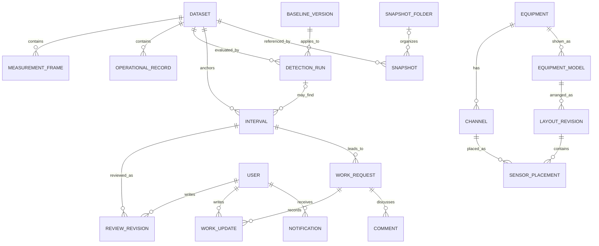

# 어떤 데이터를 어떤 이름으로 주고받을지

> 개발 전 계약안. 실제 API나 DB가 만들어졌다는 뜻은 아님. 아래 이름을 먼저 맞춰 놓고 화면·서버·분석 코드를 나눠 개발할 예정.

## 1. 시각을 두 종류로 구분

**2024년 측정 시각과 오늘 팀원이 작업한 시각은 서로 다름.** 데이터를 재생한다고 2024년 측정값의 시각을 오늘로 바꾸지 않음.

| 시각 | 저장 방법 | 화면에서 뜻하는 것 |
|---|---|---|
| 원자료에 적힌 시각 | 원문 + 정렬용 동일 형식 시각 + 출처의 시간 기준 | 채널값·조업·과거 정비가 기록된 때 |
| 출처가 확인된 UTC 시각 | 시간대가 확인된 자료만 추가로 계산 | 다른 수집 시스템과 맞출 수 있는 시각 |
| 서버가 받은 시각 | UTC | 지금 서버에 도착한 때 |
| 판단·요청·수정 시각 | UTC, 화면은 설정한 시간대로 표시 | 팀원이 실제로 행동한 때 |
| 작업 예정일 | 날짜 또는 시간대가 명시된 시각 | 앞으로 해야 할 일 |

현재 2024 원자료에는 시간대가 명시되지 않았음. 프로젝트 화면에서는 원문 시각을 유지하고, 이를 UTC로 간주해 9시간을 더하지 않음. `source_timezone`과 `recorded_at_utc`는 확인 전까지 `null`로 둠.

정렬용 `recorded_at`은 `YYYY-MM-DDTHH:mm:ss.ffffff` 문자열로 통일하고 원문과 정밀도는 따로 보존함. 같은 `source_clock_id` 안에서 비교함. 다른 시간 기준의 자료는 대응 관계를 확인하기 전까지 같은 순간으로 연결하지 않음.

캘린더도 **자료에 기록된 2024년 흐름**과 **현재 팀의 예정 작업**을 구분함. 현재 요청은 관련 2024년 구간으로 연결될 수 있지만 같은 날짜의 일처럼 합치지 않음.

## 2. 데이터 묶음과 원본 행

기존 내보내기 자료에는 345,390행, 22채널, 14LOT가 있음. 이 개수를 검사 기준으로 쓸 수는 있지만 프로그램이 이 개수만 허용하게 만들지는 않음.

기존 `cal01_base_v1.csv`는 약 432 MB임. 브라우저에서 전체 파일을 읽어 JSON으로 만든 뒤 한 번에 보내는 방식은 사용하지 않음. 개발 전에 파일을 복사하거나 서버에 올리는 작업도 이번 설계에는 포함하지 않음.

등록 기본안은 브라우저에서 앞 100개 레코드만 미리 보고, 10 MiB씩 나눠 서버로 전송하는 방식임. 큰 필드는 미리보기를 생략하고 전체 파싱은 서버에서 스트리밍으로 처리함. 파일당 최대 1 GiB를 시작 설정으로 두고 실제 환경에 맞춰 조정함. 묶음 번호·크기·해시를 확인해 전송을 이어갈 수 있게 하고, 전체 파일의 해시가 맞은 뒤에만 등록을 시작함.

사용자는 파일 또는 `processed` 폴더를 선택하고 팀에 등록할 파일을 확인함. 브라우저의 `C:\\...` 경로를 서버가 직접 읽을 수 있다고 가정하지 않음. 서버 PC에 이미 있는 파일을 등록하는 기능은 관리자가 지정한 데이터 폴더 안에서만 읽게 하고, 팀원이 보낸 임의 경로를 열지 않음. 원본 센서 파일, 라벨 파일, 조업·정비 기록은 역할을 선택해서 하나의 등록 묶음으로 연결함.

| 대상 | 주요 값 |
|---|---|
| `data_sources` | 수집원 ID, 파일/HTTP 구분, 설비, 시간 기준, 설정 버전 |
| `datasets` | 데이터 묶음 ID, 원본 파일 해시, 변환 규칙 버전, 등록 상태, 등록자 |
| `source_files` | 파일 이름, SHA-256, 크기, 원본 보관 경로, 행 수 |
| `measurement_frames` | 원본 행 ID, 설비, LOT, 강종, 측정 시각, 채널값 |
| `channels` | 채널 ID, 표시 이름, 단위, 공정 구역, 수집원 |
| `operational_records` | 조업·계획·감지·정비·부품 연결 기록과 출처 |

채널마다 행을 22개씩 늘리지 않고, 한 측정 시각의 값을 `values`에 함께 담는 방식으로 시작함. PostgreSQL에서는 이 부분을 JSONB로 저장함. 채널 조회·수치 검사는 등록할 때 수행함.

```json
{
  "dataset_id": "dataset_example",
  "source_id": "cal01_temperature_csv",
  "source_record_id": "temperature.csv:row:102",
  "equipment_id": "P1-CR1-CAL01",
  "lot_no": "240001",
  "grade": "SGCC",
  "recorded_at_raw": "2024-01-02 03:36:00",
  "recorded_at": "2024-01-02T03:36:00.000000",
  "source_clock_id": "project_2024_recorded_clock",
  "source_timezone": null,
  "recorded_at_utc": null,
  "received_at": "2026-10-20T02:00:00Z",
  "values": {
    "TC-Z3": 860.1,
    "OP-Z3": 0,
    "CP-Z4": null
  },
  "source_annotations": {
    "LABEL": 1,
    "EXCLUDED": false,
    "LABEL_VERSION": "example_only"
  }
}
```

위 숫자와 ID는 형식 설명용 예시임.

- `0`과 결측 `null`은 다름. 출력이 0이라는 이유로 지우지 않음.
- 숫자로 바뀌지 않는 값은 조용히 0으로 바꾸지 않음. 원문과 오류 행을 별도로 남김.
- 원자료 `LABEL`, `EXCLUDED`는 출처의 표시임. 새 Z-score 결과나 현재 팀 판단으로 덮어쓰지 않음.
- 원본 파일 해시와 행 번호를 묶어 원본 행을 구분함. 같은 등록 요청을 다시 보내도 같은 행이 중복되지 않게 함.
- 같은 수집원 ID·원본 행 ID에 다른 값이 오면 충돌 목록으로 보냄.
- LOT·시각이 같은 행이 발견돼도 임의로 마지막 행만 남기지 않음. 중복인지 별도 관측인지 확인함.
- 주요 조회 인덱스는 `(dataset_id, lot_no, recorded_at)`와 `(dataset_id, equipment_id, recorded_at)`로 시작함.

CSV는 작은 묶음으로 읽고 임시 등록 상태에 넣음. 전체 검사와 원본 행 수 확인이 끝난 데이터만 팀 공용 목록에 표시함. 오류가 난 등록을 정상 완료된 데이터처럼 보여주지 않음.

### 원본 온도와 전처리 CSV를 두 번 넣지 않음

측정값의 기준 파일은 **원본 온도 CSV 또는 `cal01_base_v1.csv` 중 하나**를 선택함. 두 파일을 합쳐 같은 측정값을 두 번 저장하지 않음.

원본 온도를 기준으로 전처리 파일의 `LABEL` 등을 붙일 경우, `LOT_NO + MEAS_DT`가 양쪽에서 유일한지와 채널값이 같은지 먼저 대조함. 연결되지 않거나 여러 행이 연결되는 부분은 따로 보여주고 자동 합치지 않음. 전처리 파일을 기준으로 사용할 때도 원본이 함께 제공되면 원본 채널값을 대조함.

기존 파생변수는 원본 파일에 그대로 보관하고 이번 제품에서 임의로 다시 계산하지 않음. 첫 수집 계약은 등록한 측정 채널과 출처의 라벨·제외 표시를 읽는 데 한정함.

채널은 현재 22개 목록을 등록해 검사함. 예전 분석의 21개 목록을 가정해 `CP-Z4M` 등을 누락하지 않음. 채널의 단위와 공정 구역에는 근거 출처·확인 상태를 남김. 예를 들어 `TC-Z9`는 사전의 과시효 설명과 기존 화면의 냉각 분류가 다르므로 매핑 검토 대상으로 남기고, 기존 화면 분류를 확정 사실로 옮기지 않음.

긴 시간의 그래프는 1분 요약을 사용하되 최솟값·최댓값·유효 개수도 함께 전달함. 구간을 좁히면 원자료를 조회함. 화면을 가볍게 만든 요약값으로 감지 결과를 다시 계산하지 않음.

### 3D와 그래프가 함께 읽을 채널값

알림이 생기지 않은 정상 범위의 값도 화면에서 갱신되어야 함. 따라서 알림 조회와 별도로 `GET /api/current-frame`을 사용함.

| 모드 | 어떤 시각을 기준으로 가져오는지 |
|---|---|
| 과거 자료 보기 | 사용자가 선택한 원자료 시각까지의 값. 선택 시각보다 미래인 행은 사용하지 않음. |
| CSV 재생 | 해당 `run_id`가 처리한 가상 시각과 원본 행 위치까지의 값. 아직 재생하지 않은 행은 서버에서 제외함. |
| 실제 수집 | 시간대가 확인된 측정 UTC 시각과 현재 수집 상태. 미래 시각·수집 순서 오류는 별도 품질 상태로 처리함. |

응답에는 `mode`, `dataset_id`, `run_id`, `source_clock_id`, `anchor_time`, 채널별 `value`, `measured_at`, `time_basis`, `age_seconds`, `quality_status`, `baseline_version_id`, `detection_status`를 담음. `time_basis`는 원자료 시각인지 UTC인지 표시함.

데이터가 오래됐는지는 소스에 저장한 `stale_after_seconds`로 판단함. 과거·재생 모드에서는 선택 시각·가상 시각을 기준으로 비교하고, 2024년 자료를 오늘 시각과 비교해 전부 수집 지연으로 만들지 않음. 비교할 시간 기준이나 기준 간격이 없으면 `판단할 시간 기준 없음`으로 표시함.

채널값이 없으면 `value: null`과 `관측 없음`을 보냄. 마지막 값이 있어도 측정 시각과 지연 상태를 함께 표시하며, 0이나 정상으로 바꾸지 않음. 수치의 품질 상태와 범위 이탈 여부는 별개 필드임.

화면이 열려 있을 때 재생 진행 상태와 현재 프레임을 2초 간격으로 조회함. 과거 화면은 선택 시각이 바뀌었을 때 조회함. 3D·채널 정보·그래프의 현재 위치가 같은 응답 기준을 사용함.

## 3. 과거 데이터 재생

| 값 | 뜻 |
|---|---|
| `mode` | `historical`, `replay`, `live` |
| `run_id` | 재생 한 번을 구분하는 ID |
| `dataset_id` | 재생하는 원본 데이터 |
| `baseline_version_id` | 이번 재생에 적용한 Z-score 기준 |
| `virtual_recorded_at` | 지금 재생 중인 원자료 시각 |
| `started_at`, `updated_at` | 실제 서버 시각 |
| `cursor` | 마지막으로 처리한 원본 행 |

재생은 기존 측정값을 참조함. 실행할 때마다 원자료를 다시 쌓지 않음. 재생 결과는 `run_id`로 분리하여 실제 수집 알림과 섞이지 않게 함.

속도를 바꿔도 계산에는 원래 측정 간격을 사용함. 잠시 멈추고 이어 재생해도 같은 원본 행·기준 버전의 결과와 알림이 두 번 생기지 않게 함.

실제 수집 API는 출처의 시간대 또는 UTC 시각을 필수로 받도록 설계함. 실제 장비 연결은 별도 범위이며, 첫 시연의 CSV 재생을 실시간 공장 수집으로 소개하지 않음.

## 4. Z-score 기준 파일

Z-score 계산 방법과 구간을 묶는 규칙은 [감지 기준](04-detection.md)에서 정함. 다른 모듈은 아래 정보가 있는 기준 버전을 받아 사용함.

| 필드 | 필요한 이유 |
|---|---|
| `baseline_version_id`, `method_version` | 같은 결과를 다시 계산하기 위해 |
| `channel_id`, `equipment_id` | 어느 값에 적용할지 알기 위해 |
| `scope` | 강종·조업 상태를 나누는지 명시하기 위해 |
| `reference_dataset_id`, `reference_ranges` | 평균·표준편차를 구한 원본을 찾기 위해 |
| `excluded_range_ids`, `reference_cutoff` | 기준에서 뺀 구간과 미래값 사용 여부를 확인하기 위해 |
| `mean`, `std`, `ddof`, `sample_count` | 기준 계산을 재현하기 위해 |
| `upper_z`, `lower_z` | 어느 값을 벗어나면 표시할지 알기 위해 |
| `quality_status` | 기준 부족·표준편차 0·사용 가능을 구분하기 위해 |
| `aggregation`, `min_valid_samples` | 원자료/요약값과 기준 계산에 필요한 최소 유효 표본 수를 명시하기 위해 |
| `max_gap_seconds`, `recovery_rule`, `episode_rule` | 허용 관측 공백과 복귀·종료 방법을 같은 규칙으로 적용하기 위해 |
| `created_by`, `approved_by`, `activated_at` | 누가 만들고 언제 사용하기 시작했는지 남기기 위해 |

활성화한 기준은 수정하지 않고 새 버전을 만듦. 기준에 없는 강종이나 상태가 들어왔을 때 다른 기준을 조용히 대신 적용하지 않음. 대체 기준이 필요하면 설정에 명시함.

감지 결과에는 측정값, 계산한 Z-score, 기준 버전, 원본 행 ID를 남김. 이상 후보 구간에는 시작·끝, 채널, 최대 이탈, 이탈 개수, 관측 공백 여부를 남김. 원자료에서 확인된 범위를 넘겨 종료 시각을 추정하지 않음.

## 5. 판단과 현장 요청



자동 감지와 사람이 고른 구간을 공통 `intervals`로 연결함. `origin`은 `detected` 또는 `manual`, `detection_run_id`는 자동 감지일 때만 필수임. 두 경우 모두 데이터 버전·LOT·채널 ID 목록·시작·끝·시간 기준을 저장함. 판단·현장 요청·스냅샷은 이 `interval_id`를 참조함.

자동 감지 구간이 없어도 사람이 고른 구간으로 현장 요청을 만들 수 있음. 기존 후보를 가져올 때는 원래 후보 ID를 `legacy_candidate_id`로 보존하고 새 구간 ID와 대응시킴.

판단은 다음 네 항목을 따로 둠.

| 항목 | 예 |
|---|---|
| 조업 상태 | 운전 중 / 정지 / 재가동 / 미정 |
| 팀 판단 | 확인 필요 / 조업에 따른 변화 / 이상으로 판단 |
| 판단 근거 | 그래프, 조업 기록, 실제 현장 확인, 확인한 사람 |
| 학습 사용 | 미결정 / 포함 / 제외 + 대상 학습 + 이유 |

058의 정기수리를 위한 정지, 061의 정기수리 후 재가동이라는 팀 판단은 출처와 함께 유지함. 이것을 전체 행의 고장 라벨이나 모든 학습의 제외 표시로 자동 변환하지 않음.

현장 요청의 저장값과 화면 문구는 아래로 통일함.

| 저장값 | 화면 문구 | 다음 단계 |
|---|---|---|
| `requested` | 요청됨 | 수락됨 / 취소됨 |
| `accepted` | 수락됨 | 처리중 / 취소됨 |
| `in_progress` | 처리중 | 결과제출 / 취소됨 |
| `submitted` | 결과제출 | 확인완료 / 처리중 |
| `completed` | 확인완료 | 종료. 추가 작업은 연결된 새 요청으로 남김 |
| `cancelled` | 취소됨 | 종료. 취소 이유 유지 |

- 담당팀 사람이 수락하면 담당자를 기록함.
- 담당자가 현장 결과를 작성하고, 요청자가 확인완료로 바꿈. 요청자는 모니터링팀일 수도, 현장팀일 수도 있음.
- 추가 확인이 필요하면 요청자가 이유를 남기고 처리중으로 되돌림.
- 요청됨·수락됨·처리중 상태는 요청자가 사유를 남기고 취소할 수 있음. 담당자에게 알림을 보내고 이력을 유지함. 첫 버전에는 두 사람의 별도 취소 승인 절차를 넣지 않음.
- 담당자 변경, 기한 변경, 상태 변경은 모두 변경 전후 값과 작성 시각을 남김.
- 작업이 완료됐다고 채널값까지 정상으로 확정하지 않음.
- 예정 시작·종료와 실제 시작·종료를 각각 저장함. 캘린더에서 서로 다른 표시로 보여줌.

과거 CSV의 `DETC_DT`는 이상 감지 기록 시각, 실제 정비 시작·종료는 정비 작업 시각임. 부품에 별도 교체 시각이 없으면 연결된 `WO_NO` 작업 시간으로 표시하고 그 사실을 함께 적음.

### 3D 모형과 채널 표시 위치

3D는 필수 기능이며 아래 정보를 저장함.

| 대상 | 주요 값 |
|---|---|
| `equipment_models` | 설비 ID, GLB 파일 ID·해시, 모형 버전, 축 방향, 좌표 단위, 구역 이름 |
| `layout_revisions` | 모형 버전, 배치 버전, 작성자, 작성 시각, 이전 배치 버전 |
| `sensor_placements` | 채널 ID, 구역 ID, 모형 안의 x·y·z, 연결된 부품/노드 ID, 실제 위치 확인 여부 |

단위가 확인되지 않은 모형 좌표를 미터라고 쓰지 않음. 모형이 바뀌면 기존 채널 좌표를 새 모형에 무조건 적용하지 않고, 대응 관계를 검사함.

3D에서 채널을 누르면 `channel_id`와 현재 데이터 버전·LOT·시각을 그래프에 전달함. 이상 후보와 현장 요청도 같은 ID를 참조함. 별도 센서 번호를 임의로 만들어 연결하지 않음.

위치를 바꾸는 요청도 `revision`을 사용함. 이전 배치로 되돌리는 동작은 이력을 지우지 않고 새 배치 버전으로 저장함. 스냅샷에는 당시 모형·배치 버전을 함께 남김.

### 스냅샷과 팀 공통 폴더

`snapshots`에는 기존 ID, 작성자, 제목·설명, 이미지 파일 ID, 구간 ID, 데이터·기준·모형·배치 버전을 저장함. 화면을 다시 열 때 사용할 채널 목록, 노란 구간, 확대 범위, 순차 창 설정, 기록의 앞뒤 기간도 함께 남김.

`snapshot_folders`와 `snapshot_placements`는 팀 공통 상태임. 배치에는 스냅샷 ID, 폴더 ID 또는 미분류, 정렬 순서를 저장함. 폴더 이동·드래그 재정렬은 공통 `organization_revision`을 검사하여 다른 사람의 최근 순서를 덮어쓰지 않게 함.

스냅샷 삭제는 작성자 또는 지정된 관리 권한으로 처리하고 `deleted_at`을 남김. 이미지와 원래 폴더·순서를 즉시 지우지 않아 복원할 수 있게 함. 복원해도 같은 스냅샷 ID를 유지함. 기존 데이터 이전에서도 폴더·스냅샷·작성자의 대응표를 보존함.

## 6. API 목록

| 요청 | 역할 |
|---|---|
| `POST /api/session/login`, `POST /api/session/logout`, `GET /api/me` | 로그인·로그아웃·내 팀과 권한 |
| `POST /api/uploads`, `GET /api/uploads/{id}` | 업로드 시작, 서버가 받은 묶음 확인 |
| `PUT /api/uploads/{id}/parts/{number}`, `POST /api/uploads/{id}/complete` | 묶음별 해시 검사·중복 방지, 완성 파일 검사. 검사를 통과한 파일 ID만 등록에 사용 |
| `POST /api/imports`, `GET /api/imports/{id}` | 파일 등록 작업과 진행 상태 |
| `PUT /api/imports/{id}/chunks/{index}`, `POST /api/imports/{id}/complete` | 큰 파일을 나눠 전송·이어 보내기, 전체 해시 확인 후 등록 시작 |
| `GET /api/datasets`, `GET /api/datasets/{id}` | 사용할 데이터와 출처 |
| `GET /api/series` | 데이터·LOT·채널·기간에 맞는 원자료 또는 요약값 |
| `GET /api/current-frame` | 과거 선택 시각·재생 진행 시각·실제 수집 모드에 맞는 채널값과 품질 상태 |
| `GET /api/records` | 같은 시간 기준의 조업·정비·부품 기록 |
| `POST /api/replay-runs`, `GET /api/replay-runs/{id}`, `PATCH /api/replay-runs/{id}` | 과거 데이터 재생·현재 진행 위치·정지·속도 변경 |
| `POST /api/baselines`, `GET /api/baselines`, `GET /api/baselines/{id}` | 계산 근거를 포함한 기준 버전 등록·조회 |
| `POST /api/baselines/{id}/activate` | 검증된 기준을 권한이 있는 사람이 활성화 |
| `GET /api/anomaly-intervals`, `GET /api/anomaly-intervals/{id}` | 감지된 구간과 계산 근거 |
| `POST /api/observed-intervals` | 사람이 직접 선택한 구간 |
| `PATCH /api/intervals/{id}/review` | 조업 상태·팀 판단·학습 사용 판단 |
| `GET /api/work-requests`, `GET /api/work-requests/{id}` | 내가 보낸 요청·담당팀 요청·개별 요청과 이력 |
| `POST /api/work-requests`, `PATCH /api/work-requests/{id}` | 현장 요청·담당·기한·상태·결과 |
| `POST /api/work-requests/{id}/comments` | 해당 요청에 이어지는 대화 |
| `GET /api/calendar` | `kind=source_history`는 원자료 시간 기준, `kind=team_schedule`은 현재 팀의 일정 시간 기준으로 조회 |
| `GET /api/notifications?after={cursor}` | 새 알림과 다음 조회 위치 |
| `POST /api/notifications/read` | 읽음 상태 저장 |
| `GET /api/snapshots`, `POST /api/snapshots`, `PATCH /api/snapshots/{id}` | 같은 데이터 구간의 그림과 설명 조회·저장·수정 |
| `DELETE /api/snapshots/{id}`, `POST /api/snapshots/{id}/restore` | 삭제 표시·같은 ID로 복원 |
| `GET /api/snapshot-organization`, `PATCH /api/snapshot-organization` | 팀 공통 폴더·순서 조회, 폴더 생성·이름 변경, 스냅샷 이동·재정렬 |
| `GET /api/equipment/{id}/layout`, `PATCH /api/equipment/{id}/layout` | 3D 채널 표시 위치 조회·저장 |
| `POST /api/ai-summaries`, `GET /api/ai-summaries/{id}` | 근거를 지정한 요약 요청·결과 조회 |
| `POST /api/ingest/frames` | 향후 수집 프로그램의 묶음 전송. 첫 시연에서는 연결 시험용 |

화면을 먼저 만들어 놓고 API 이름을 맞추지 않도록 이 목록으로 서버·화면 작업을 나눔. 경로는 구현 전에 검토할 수 있지만, 개발 중 바꾸면 두 쪽을 함께 수정함.

공통 규칙:

- 저장 요청은 `request_id`, 수정 요청은 `request_id`와 `revision`을 포함함.
- 성공 응답에 실제 저장된 값과 새 `revision`을 반환함.
- 수정 충돌은 `409`와 현재 서버 내용을 반환함. 내 입력은 화면에 유지함.
- 긴 목록은 `cursor`, `limit`, `next_cursor`로 나눠 읽음.
- `series`와 `current-frame`은 모드·시간 기준·데이터 버전을 함께 검사함. 재생 화면 요청에 미래 행 범위를 넣어도 해당 실행의 처리 위치까지만 반환함.
- 오류는 `code`, 읽기 쉬운 `message`, 잘못된 필드만 반환함. 비밀번호·API 키·내부 DB 오류문은 반환하지 않음.
- 파일 선택과 실제 업로드는 구분함. 팀 공용으로 등록했을 때만 서버 저장 작업을 시작함.
- 파일은 서버가 만든 ID로 보관하고 사용자 파일명을 경로로 실행하지 않음. 이미지·3D 파일 조회도 로그인과 대상 권한을 검사함. 작업 사진은 PNG/JPEG와 시작 상한 10 MiB로 제한하고 실제 형식을 확인함. 스냅샷은 그래프 영역만 캡처해 로그인 입력이나 비밀 설정을 포함하지 않음.
- 수집 API는 사람의 세션 쿠키 대신 수집원별 제한된 인증키를 사용함. 이 키로 판단이나 작업 상태를 바꿀 수 없음.

## 7. 캘린더와 AI가 잘못 말하지 않게

캘린더에서 “이상이 많음”은 **후보 구간 수**, **관측된 값 중 범위를 벗어난 비율**, **관측한 시간**을 함께 보고 판단함. 원자료 개수만 세면 더 자주 측정한 날이 더 나빠 보일 수 있음. 자료가 없는 날짜는 0건이 아니라 “관측 없음”으로 표시함.

Claude에는 사용자가 고른 구간의 요약 수치, 관련 기록, 팀 판단, 출처 ID를 보냄. 전체 CSV와 계정 정보는 보내지 않음. 응답은 요약·근거 ID·추가 확인할 점으로 나누고, 존재하지 않는 근거 ID를 인용하면 결과를 그대로 확정 문장으로 표시하지 않음.

AI가 작성한 요청문은 초안임. 팀원이 보내기 전에는 현장 요청이나 알림이 만들어지지 않음. AI가 조업 상태·고장 여부·학습 제외를 자동으로 확정하지 않음.
