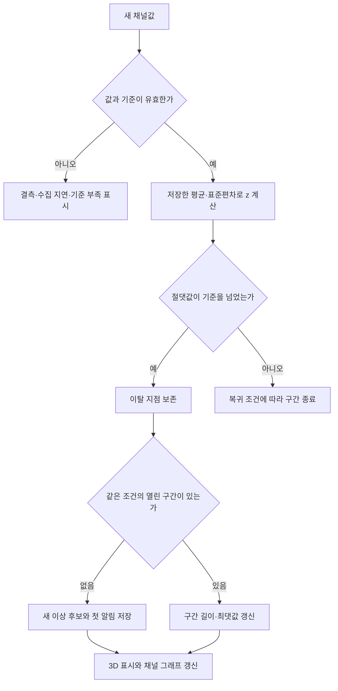

# 감지와 해석 설계

**Z-score는 기준에서 얼마나 벗어났는지 알려줌. 고장인지, 조업 변화인지, 현장 확인이 필요한지는 기록과 팀 판단을 함께 봐야 함.** 따라서 감지, 조업 상태, 팀 판단, 학습 제외를 각각 저장함.

## 1. 과거 분석과 앞으로 들어오는 값은 기준이 다름

| 모드 | 평균·표준편차를 구하는 자료 | 화면 표현 |
| --- | --- | --- |
| 과거 자료 분석 | 사용자가 선택한 과거 구간 | 선택한 자료 안에서 벗어난 값 |
| 기준 고정 모니터링 | 사전에 승인하고 저장한 기준 자료 | 저장한 기준을 벗어난 새 값 |
| CSV 재생 | 위 두 방식 중 선택한 기준. 원본 시각은 유지 | CSV 재생 중, 기준 방식과 버전 표시 |

같은 자료의 평균과 표준편차로 계산하는 것이 `zscore`, 별도의 비교 자료로 계산하는 것이 `zmap` 방식임. 모니터링에서는 비교 자료의 평균·표준편차를 저장하고 이후 값에 적용함. 팀이 만든 과거 Z-score 분석을 변경하지 않고, 새 프로그램의 모드를 따로 정의하는 것임. [SciPy zscore](https://docs.scipy.org/doc/scipy/reference/generated/scipy.stats.zscore.html), [SciPy zmap](https://docs.scipy.org/doc/scipy/reference/generated/scipy.stats.zmap.html)

```text
z = (측정값 - 기준 평균) / 기준 표준편차
처음 제안하는 이탈 조건: abs(z) > 3
```

`3`은 시작 기준안임. 설비 안전 한계나 검증된 고장 판정값은 아님. 기준선은 그래프에 `평균 ± 3×표준편차`로 표시함. 정확히 경계와 같은 값은 `>` 조건에서 이탈이 아님. pandas와 SciPy의 기본 표준편차 옵션이 다를 수 있으므로 `ddof`를 기준 파일에 반드시 저장함. 기존 담당자의 산출물과 같은 옵션을 사용해야 함.

## 2. 감지 기준 파일에 남길 내용

| 항목 | 저장하는 이유 |
| --- | --- |
| 기준 ID, 버전, 승인자, 활성화 시각 | 나중에 어떤 기준으로 감지했는지 확인 |
| 원본 파일 해시, 기준 LOT·구간, 제외 구간과 이유 | 계산에 들어간 자료를 다시 찾기 |
| 채널, 단위, 강종 조건, 조업 상태 조건 | 서로 다른 조건의 값을 무조건 섞지 않기 |
| 시간 집계 방식, 유효 관측 수 조건, ddof | 평균·표준편차를 동일하게 재현 |
| 유효 표본 수, 평균, 표준편차, 이탈 기준 | 실행 중 매번 다시 계산하지 않기 |
| 구간을 묶는 허용 공백, 종료 조건, 최소 유효 표본 수 | 이탈 지점과 알림 구간을 같은 규칙으로 만들기 |
| 시간대·결측·중복 처리 규칙 | 입력 해석을 고정하기 |

기준을 바꾸면 새 버전을 만듦. 진행 중인 감지 구간을 끝내고 새 기준부터 새 구간으로 기록함. 과거 결과와 이미 저장된 판단은 그대로 둠. 새 기준으로 재분석한 결과는 별도 실행 번호에 저장함.

모니터링 기준의 자료 끝 시각은 감지 시작 이전이어야 함. 재생 구간 뒤의 자료로 기준을 만들었다면 `과거 분석`으로 표시하고, 앞으로 들어오는 값을 예측한 성능으로 설명하지 않음. `min_valid_samples`, `max_gap_seconds`, 적용 조업 상태와 상태를 모를 때의 처리까지 기준 설정에 명시해야 활성화할 수 있음.

원래 1초 자료인지, 1분 집계 자료인지 혼합해서 비교하지 않음. 화면용 1분 요약은 선을 빨리 그리기 위한 것이며 감지용 원자료를 대체하지 않음.

## 3. 기준 자료가 없으면 감지 불가로 표시

- 기준의 유효 자료가 부족하거나 표준편차가 0이면 `기준 부족`임. z를 0으로 채우지 않음.
- 처음 보는 강종에 일치하는 기준이 없으면 `적용할 기준 없음`임. 다른 강종 기준을 자동 적용하지 않음.
- 결측·숫자가 아닌 값은 점수 계산에서 제외하고 데이터 품질로 기록함. OP의 0은 실제 값이므로 남김.
- 오래된 값이나 통신 중단은 `수집 지연`으로 표시함. 값의 범위 이탈과 별개임.
- 실시간 전송 묶음 안에서는 측정 시각 순서로 처리함. 이미 처리한 시각보다 늦게 도착한 과거 행은 원본과 `지연 도착` 표시를 보존하되, 현재 표시값을 뒤로 돌리거나 지나간 알림을 조용히 다시 만들지 않음. 과거 구간 재계산은 별도 실행으로 남김.
- `CP-Z4M`처럼 작은 값에 일반적인 고정 epsilon을 적용해 상수로 오판하지 않음. 단위·정밀도를 반영한 검증을 함.

`CLN-IN`과 건조 채널은 사전의 강종 비반응 설명을 고려해 공통 기준 후보로 시작하되, 근거 없이 무조건 강종별로 나누거나 모델에서 빼지 않음. 가열·균열 등은 채널별로 강종·조업 조건을 검토함. **최종 기준 묶음과 수치는 모델링 담당자의 현재 Z-score 산출물을 확인한 뒤 확정함.**

## 4. 값은 모두 남기고, 알림만 구간으로 묶음



첫 버전의 기본안은 첫 유효 이탈에서 후보를 열고 한 번 알리는 것임. 지속시간을 기다려 최초 감지를 숨기지 않음. 같은 채널·LOT·강종 조건·기준 버전·실행 모드의 연속 이탈만 한 구간으로 묶음.

예를 들어 이탈값이 연속으로 들어와도 알림 100개를 만드는 대신, 하나의 열린 후보에 시작 시각·최근 이탈 시각·최대 이탈값·유효 지점 수를 갱신함. 복귀값이 들어오면 종료함. 운영 중 반복 알림을 줄이는 추가 지속시간 조건은 원래 이탈 결과와 분리해 나중에 검증함.

다음 경우에는 구간을 이어 붙이지 않음: LOT 변경, 기준 버전 변경, 강종 조건 변경, 설정한 허용 공백 초과. 긴 관측 공백은 정상 복귀가 아니라 `관측 중단으로 종료`임. 허용 공백은 데이터 소스별 수집 간격을 확인해서 설정하며, 60개 관측값을 60초로 간주하지 않음.

첫값과 마지막값만으로 사이의 모든 시각이 이탈했다고 단정하지 않음. 관측 지점 수와 구간의 시각 범위를 함께 표시함. 기준 변경·재생 되감기·재수집은 실행 번호와 중복 방지 키로 구별함.

구간의 시작·끝은 첫 이탈 관측과 마지막 이탈 관측을 포함함. 복귀 관측 시각은 `recovered_at`으로 따로 남김. 이탈 관측이 하나면 점으로 표시하고 가짜 길이를 붙이지 않음. 되감아 다시 감지할 때는 새 `run_id`로 만들고, 일시정지 후 계속하기는 같은 실행으로 이어감.

## 5. 조업과 정비를 함께 읽는 방법

| 기록 | 연결 기준 | 하지 않을 해석 |
| --- | --- | --- |
| 조업 이벤트 | 같은 설비·라인의 기록 시각 | 이벤트 사이 전체 운전 상태를 임의로 채움 |
| 정기수리 계획 | 계획 날짜·기간 | 실제 정비 시각이나 완료 결과로 간주 |
| 정비 이상 감지 | 정비 이력의 감지 시각 | 고장이 시작한 정확한 시각으로 간주 |
| 실제 정비 | 작업번호와 실제 시작·종료 | 계획과 실제를 하나로 덮어씀 |
| 부품 교체 | 부품 교체 기록의 작업번호 → 정비 작업 | 별도 교체 시각이 없는데 시각을 만들어냄 |

058은 정기수리를 위한 정지, 061은 정기수리 후 재가동이라는 **팀의 확정 판단을 유지**함. 이 판단이 모든 채널의 고장 확정이나 모든 학습의 자동 제외를 뜻하지는 않음.

원자료의 `LABEL`, 기존 팀 판단, 신규 Z-score 후보, 학습 제외를 분리해서 표시함. 기존 LABEL=0은 해당 규칙에서 미검출이고, LABEL=1은 임시 라벨임. 정답으로 가정한 정확도·F1 점수를 제품 성능처럼 내세우지 않음.

### 여러 모니터에서 이상 후보를 알아보는 방법

각 화면에서 보고 있는 설비를 기준으로 알림을 받음. 전체 설비를 보는 화면에는 모든 후보가, CAL01 화면에는 CAL01 후보가 표시됨.

1. 새 후보가 들어오면 화면 가장자리가 천천히 붉어짐. 그래프와 글자는 계속 읽을 수 있음.
2. 3D에서 해당 구역과 채널을 붉게 강조함. 채널명, 측정값·단위, 기준 범위, 발생 시각을 함께 표시함.
3. 경고를 누르면 그 채널과 발생 구간으로 이동함. 현장 요청에 같은 구간을 붙일 수 있음.
4. `확인`을 누르면 움직임만 멈춤. 확인한 사람·시각을 남기고, 이상 후보는 해결될 때까지 목록에 유지함.

같은 후보가 이어지는 동안 새 경고를 계속 만들지 않음. 다른 채널의 새 후보는 별도로 알림. 움직임 줄이기 설정에서는 정적인 붉은 테두리를 사용함. 연결이 끊기면 `연결 끊김`을 표시하고, 재연결 후 마지막으로 받은 번호 다음의 알림을 다시 가져옴.

빨간 표시는 `이상 후보 발생`을 뜻함. 팀의 `고장 확인`, 값의 `기준 범위 복귀`, 사용자의 `알림 확인`은 서로 다른 상태로 저장함. 과거 CSV의 LABEL=1을 새로 들어온 실시간 경고처럼 보여주지 않음.

## 6. 월별·연간 비교에서 분모를 숨기지 않음

기본 화면은 날짜별 관측 유무와 기준 이탈 **구간 수**를 보여줌. 버튼으로 `팀이 확인한 이상`을 따로 선택함. 채널이 여러 개면 같은 시간에 여러 후보가 생길 수 있으므로 사건 한 건과 채널별 후보 수를 혼동하지 않음.

이탈 비율은 `이탈한 유효 관측 수 / 점수를 계산한 유효 관측 수`로 정의하고 `관측값 기준 비율`이라고 표시함. 불규칙한 관측에서 시간 비율이라고 부르지 않음. 분모가 0이면 0%가 아니라 `비교할 자료 없음`임.

관측이 며칠뿐인 2024년 자료를 연간 화면으로 펼치더라도 빈 날을 정상으로 칠하지 않음. 다른 기준 버전·집계 방식은 필터로 나누고, 모드를 섞은 순위나 월별 추세를 만들지 않음.

## 7. Claude는 근거를 읽고 설명 초안을 만듦

Claude에 요청하는 일은 세 가지임: 선택 구간에서 달라진 값 요약, 같은 시간대 조업·정비 기록 정리, 현장 확인 요청 문구 초안. 답변에는 사용한 채널 구간과 기록 ID를 붙여 다시 열 수 있게 함.

서버가 확인된 자료만 묶어 전송하고, 원본 CSV 전체·접속 코드·비밀번호·다른 사용자의 비공개 내용은 보내지 않음. 첫 사용 전 전송할 필드를 보여줌. API 키는 서버 설정에만 둠. 모델은 설정값으로 선택하며 요청·출력 길이, 동시 요청, 하루 비용 상한을 설정함.

결과는 `AI 설명 초안`으로 저장함. 사람이 확인 후 팀 판단이나 요청에 채택함. AI는 감지 기준 변경, 고장 확정, 설비 제어, 학습 제외, 작업 완료를 자동 수행하지 않음. 기록 안의 지시문은 분석할 자료로만 취급함.

API가 지연되거나 키가 없어도 감지·알림·현장 요청은 계속 동작해야 함. 타임아웃 후 실패 상태를 표시하고 사용자가 재시도함. 출처 ID가 없거나 현재 선택 구간과 다른 출처를 가리키는 응답은 채택 전에 걸러냄. AI 채택 전후 내용과 작성자를 남김. [Anthropic 공식 Python SDK](https://github.com/anthropics/anthropic-sdk-python)

## 8. 저장된 모델과 registry

모델링 저장소(pdm-project)의 `05_save_models` 노트북이 만든 모델을 `models/`에 둠. 모델 하나는 구역 하나만 예측함. 입력이 그 구역 센서와 공통 컬럼이기 때문임.

```
models/
  registry.json                      # 모델 ID → 경로, 구역, 라벨 버전, 입력 태그, 상태, 근거
  v6/
    zscore.json                      # 규칙형 Z-score 설정 (지난 값, min_periods 30, |Z| > 3, ddof 0)
    final/<구역>/
      rf-all14-<날짜>.joblib         # RandomForest, 14 LOT 전체. 배포용 (status: active)
      rf-fold13-<날짜>.joblib        # RandomForest, LOT 1 ~ 13. 재현 확인용 (status: check_only)
      iso-all14-<날짜>.joblib        # IsolationForest, 14 LOT 전체. 검토 후보 표시용
      features.json                  # 입력 컬럼 순서와 계산 규칙. 서버는 이 규칙대로 입력을 만들어야 함
      config.json                    # 스위치, 파라미터, 학습 LOT, 데이터 해시, 재현 결과
      metrics.json                   # 03 시간순 걷기 결과 (F1, 정밀도, 재현율, 헛경보)
      fold13_expected.json           # fold13 모델의 LOT 133 예측 (입력 계산이 맞는지 확인할 때 씀)
```

| 규칙 | 내용 |
| --- | --- |
| 이름 | `cal01-<라벨버전>-<입력태그>-<구역>-<모델>-<학습범위>-<날짜>`. 입력 태그 `final` = `common_roll10_zpast_opcommon_furnace_control` |
| 구역별 선택 | registry에서 그 구역의 `status: active` 중 라벨 버전이 가장 높은 것. 없는 구역은 Z-score만 씀 |
| 근거 단계 | `evidence` 칸. Z3 ~ Z6은 "팀 라벨 있음", Z-score는 "규칙형". 화면에 함께 보여 줌 |
| 교체 | 새 모델은 새 ID로 더하고 이전 것은 `retired`로 바꿈. 파일은 지우지 않음 |
| 가져오기 | `python scripts/import_models.py --from ../pdm-project/models`. 이미 있는 ID는 건너뜀 |
| 입력 계산 확인 | `fold13_expected.json`의 분 단위 예측과 서버 계산 결과가 같아야 함. 다르면 `features.json`의 규칙과 어긋난 것 |
| 버전 | joblib은 저장한 sklearn 버전(registry의 `sklearn`)과 같은 버전으로 열어야 함 |

입력 계산은 모두 같은 LOT 안의 지난 값만 씀. 지난 값 \|Z\|는 LOT 시작 30분 뒤부터 값이 생기고, 5분과 10분 창을 씀. 모델 점수는 "팀 라벨과 3σ 후보를 재현한 정도"이지 고장 탐지 성능이 아님 (6절과 같은 기준).

