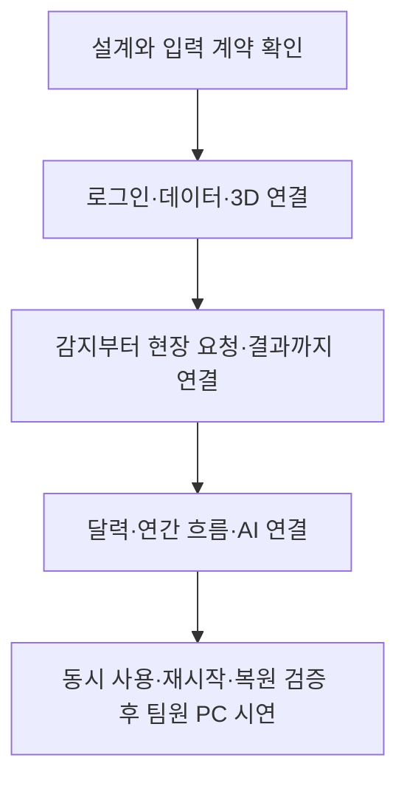

# 4일 개발 계획과 완료 기준

**설계를 확인한 뒤 개발을 시작함.** 현재 저장소에는 문서와 다이어그램만 있음. 남은 4일에는 새 연속 소둔로 모형에서 채널을 확인하고, 현장 요청 한 건을 끝내는 흐름을 먼저 연결함. 마지막 하루는 결함 수정과 팀원 PC 검증에 남겨둠.

설계 확인과 새 3D 제작 시간도 4일에 포함함. 기존 7일 분량을 그대로 압축하지 않고 아래 범위로 줄이는 안임. 팀원별 개발 업무를 이미 배정했다는 뜻은 아님. 실제 완료 여부는 매일 통과 기준으로 판단하며, 4일 안에 모든 장기 기능을 완성했다고 약속하지 않음.

## 이번 시연에서 만들 범위

| 기능 | 4일에 만들 것 | 이후로 미룰 것 |
| --- | --- | --- |
| 로그인·팀별 화면 | 5명 계정, 역할에 따른 첫 화면, 서버 권한 검사 | 회원가입·복잡한 조직 관리 화면 |
| 새 3D | 연속 소둔로 모형 한 개, 외함·롤러·강판 경로·구역 선택, 채널 위치 수정·저장 | 세부 배관·볼트·실측 CAD, 모형 여러 개 편집 |
| 데이터 | 서버의 지정된 기존 CSV 묶음 등록·재생, 조업·정비·부품 기록 연결 | 범용 브라우저 업로드·열 자동 매핑, 실제 PLC 연결 |
| 감지·소통 | 기존 Z-score 계산 기준 연결, 후보·알림, 팀 판단, 요청·수락·결과·확인 완료 | 새 감지 모델 개발, 외부 메신저·휴대전화 푸시 |
| 달력·연간 | 계획·실제·할 일, 날짜별 관측 유무·후보 수 | 복잡한 일정 편집·다중 집계 화면 |
| Claude | 선택 구간 설명 버튼 하나, 근거 표시, 실패·비용 제한 | 다회차 AI 채팅·자동 판단 |
| 모핑 | 존으로 카메라 이동, 채널 패널 펼침, 구간이 요청에 붙는 전환 | 반복 장식 효과, 모든 화면의 개별 전환 제작 |
| 기존 자료 | 기존 서버 보존, 요청에 같은 채널·구간 첨부 | 스냅샷 폴더·드래그 정리·전체 이력의 새 서버 이전 |

## 1. 코딩 전에 닫아야 하는 결정

| 결정 | 기본안 | 확인 방법 |
| --- | --- | --- |
| 필수 시연 | 3D 채널 선택 → 기준 이탈 → 현장 요청 → 조치 → 확인 | 사용자와 이 흐름으로 범위 확정 |
| 서버 PC | 팀이 계속 켜둘 수 있는 로컬 PC 한 대 | 운영체제, RAM, 여유 공간과 설치 권한 확인 |
| 접속 환경 | 팀원 브라우저 5개, 같은 망 또는 승인된 사설망 | 교육장 망의 기기 간 접속·HTTPS 방식 확인 |
| 채널과 기준 | 현재 Z-score 담당자의 기준 산출물과 같은 계산 | 채널 목록, 강종 조건, 집계 방식, ddof, 기준 구간 확인 |
| 기준 미정 값 | 임의 실전값을 넣지 않음 | 합성 예제는 예제로 표시하고 실제 결과와 분리 |
| 3D 모형 | 실제 구조를 참고해 새로 만든 연속 소둔로 모형 한 개 | 첫날 외형·강판 경로·구역을 고정하고 채널 선택→그래프까지 확인 |
| 최초 관리자 | 업무 팀 역할과 별도 지정 | 사용자 한 명을 명시적으로 지정 |
| 팀 판단 확정 | 지정된 검토 담당자가 근거를 확인한 뒤 확정 | 의견 작성·현장 결과 제출과 별도 권한으로 지정 |
| Claude | 서버 키·모델·일일 예산 | 키를 채팅에 받지 않고 로컬 비밀 설정에 입력 |

서버 장비 연결 규격이 없으면 첫 시연은 **실제 CSV의 시간순 재생**으로 정함. 실제 PLC 연결 완료라고 소개하지 않음.

첫날 기존 CSV 위치·Z-score 산출물·서버 접속 조건·Claude 설정 가능 여부를 확인함. 기준 평균·표준편차·집계 방식이 없으면 임의 값으로 실전 감지를 주장하지 않음. 이미 계산된 결과를 재생하는 대안을 쓰면 `저장된 분석 결과 재생`이라고 표시하고 실행 중 계산과 구별함.

## 2. 개발 순서

| 날 | 만들 것 | 그날 끝나야 하는 확인 |
| --- | --- | --- |
| 1일 | 설계·입력 기준 고정, 팀 접속, 두 역할 로그인, CSV 등록·조회, 새 모형·채널 연결 | 목표 PC에서 새 모형이 보임. 채널 선택→실제 그래프와 표시점 저장·복원이 됨. 다른 팀원 PC에서 접속함 |
| 2일 | Z-score·후보·알림, 조업·정비 기록, 현장 요청·수락·조치·결과·확인 완료 | 두 계정으로 업무 한 건을 끝냄. 수치 대조·중복 알림 방지와 재시작 후 저장 유지 확인 |
| 3일 | 기본 월·연간 화면, Claude 설명, 핵심 모핑, 라이트·다크 마무리 | 같은 구간이 모든 화면에서 유지됨. AI 실패 중에도 업무 가능. 종료 시 기능과 모형 구조 고정 |
| 4일 | 5명 동시 사용, 충돌·재시작·백업 복원 검증, 발표 PC 시연, 결함 수정·실행 안내 | 실제 시연 자료로 전체 흐름 완주. 빈 DB에 백업 복원. 새 기능 없이 발견한 결함을 수정 |

새 3D 제작은 첫날 안에 외함·지지 구조·롤러·강판 경로·존 선택이 있는 수준으로 제한함. 부족하면 배관·금속 표면·주변 건물의 세부 표현을 줄임. PPTX 모형으로 임의 대체하거나 2일차 업무 연결을 뒤로 미루지 않음. 기본 카메라·패널 전환은 1~2일차 기능과 함께 붙이고 3일차에 다듬음.

**2일차 끝에 업무 한 건이 완료되지 않으면 새 모형의 재질·주변 구조와 반복 장식부터 줄이고 연결 결함을 고침.** 필요하면 기본 달력도 날짜별 목록으로 단순화함. Claude 설명은 버튼 하나 수준을 유지함. 필수 흐름까지 끝내지 못하면 그 상태를 정확히 보고하고, 시연 완료로 표시하지 않음.

## 3. 먼저 끝까지 연결할 시연 한 건

1. 수진 계정으로 로그인하고 `CSV 재생`을 선택함. 2024년 측정 시각과 현재 재생 상태를 구분해서 보여줌.
2. Z3의 값이 저장한 기준을 벗어남. 3D 표시점과 알림 목록에 같은 후보가 생김.
3. 표시점을 눌러 채널 그래프를 엶. 실제 이탈 지점과 주황색 기준 이탈 표시가 같은 시각에 있음.
4. 노란 구간을 선택하고 앞뒤 조업·정비 기록을 확인함. 필요하면 Claude 설명 초안을 요청함.
5. 그 구간을 붙여 현장팀에 요청함. 정렬 계정에서 요청을 열면 같은 설비 위치·채널·구간을 봄.
6. 정렬이 요청을 수락하고 결과·실제 작업 시각을 기록함. 수진에게 결과 제출 알림이 감.
7. 요청자인 수진이 확인 완료함. 실제 작업과 현재 할 일 상태가 달력에 반영됨. 측정이 2024년이라는 이유로 현재 요청의 기한까지 2024년으로 만들지 않음.
8. 서버를 재시작하고 두 계정으로 다시 열어 판단·요청·알림·3D 위치가 남아 있는지 확인함.

## 4. 완료라고 부를 수 있는 기준

| 영역 | 통과 조건 |
| --- | --- |
| 로그인·권한 | 다른 사람의 권한을 요청 파라미터로 가장해도 서버가 차단. 로그아웃·만료·로그인 실패 제한 확인 |
| 파일 등록 | 동일 파일 재등록 시 중복 없음. 잘못된 시각·중복 행·결측을 보고하고 원본 수정 없음 |
| 기준 계산 | 같은 기준 자료·ddof로 Python 기준 계산과 일치. 경계·음수 이탈·표준편차 0·기준 없는 강종 검증 |
| 후보·알림 | 한 후보에 첫 알림 하나. 같은 실행의 중복 요청·재시작·재처리에서 이중 생성 없음. 되감아 새로 분석하면 새 실행 ID로 구분. 연결 복구 후 빠진 알림 회수 |
| 시간축 | 같은 채널·구간·기준 버전을 3D→그래프→요청 첨부에서 유지. 공백을 선으로 메우지 않음 |
| 3D | 존·채널 선택 가능. 위치 이동·취소·저장·복원 가능. 잘못된 좌표·다른 모형 버전 저장 차단 |
| 소통 | 동시 수락은 한 명만 성공. 담당자 변경·결과 수정 이력과 알림 유지. 제출과 확인 완료 분리 |
| 달력 | 계획·실제·할 일 구분. 관측 없는 날짜 표시. 같은 기준·실행의 날짜별 후보 수를 중복 없이 집계 |
| AI | 키가 브라우저에 없음. 출처 연결. API 실패·예산 초과 시에도 일반 업무 가능 |
| 보존·복구 | 기존 원자료·서버 판단은 변경 없음. 새 서버 백업을 별도 DB로 복원한 뒤 구간·알림·모형 위치 확인. 일부 기존 판단을 가져오면 해당 ID·작성자·시간을 대조 |
| 사용성 | 라이트·다크, 1366×768과 현장용 좁은 화면에서 핵심 동선 확인. 키보드로 요청·판단 저장 가능 |
| 모핑 | 설비 전체→존→채널→요청이 같은 대상을 유지. 전환 중 다른 채널 선택·창 크기 변경·뒤로 가기에도 구간과 입력 보존. 움직임 줄이기 적용 |

성능은 **검증 목표**로 잡고 1일차 장비 확인 후 기록함: 실제 규모 파일 등록 5분 이내, 일반 채널 구간 조회 2초 이내, 열린 화면의 새 알림 반영 3초 이내, 3D 표시점 조작 목표 30fps 이상. 전 구간 22채널 원자료를 브라우저에 한꺼번에 보내지 않음. 실패하면 추측으로 통과 처리하지 않고 병목과 조정안을 기록함.

## 5. 개발을 나누는 단위

| 순서 | Issue 제목안 | PR에 담을 것 |
| --- | --- | --- |
| 1 | chore: 로컬 실행과 로그인 준비 | 실행 환경, 계정·권한, 상태 점검 |
| 2 | feat: CSV와 조업·정비 기록 연결 | 데이터 등록, 원본 대조, 시간 계약 |
| 3 | feat: 새 연속 소둔로 모형과 채널 연결 | 생성 코드·구역·강판 경로, 채널 위치, 그래프 연결 |
| 4 | feat: Z-score 후보와 알림 표시 | 기준 버전, 감지 구간, 알림 복구 |
| 5 | feat: 현장 요청과 조치 결과 공유 | 업무 흐름, 수정 이력, 담당자 권한 |
| 6 | feat: 일정과 연간 이탈 흐름 표시 | 월별 계획·실제·할 일, 연간 집계 |
| 7 | feat: Claude로 구간 설명 작성 | 서버 API, 출처, 비용·실패 처리 |
| 8 | test: 팀 시연과 복원 검증 | 통합 시나리오, 실행·복구 안내 |

지금 이 Issue들을 구현 완료처럼 생성하거나 여러 PR을 미리 열지 않음. 설계 확인 후 실제 착수 단위로 생성함. 한 PR이 데이터·3D·권한을 전부 바꾸지 않게 나눔. 각 PR에는 바뀐 행동과 실제 확인 결과만 짧게 남김.

## 6. 일정이 밀릴 때 줄일 것

새 3D의 핵심 구조·채널 확인·위치 저장, 데이터 보존, 역할별 업무, 감지와 알림, 재시작 복구는 남김. 설비→채널→요청의 핵심 모핑은 3일차까지 마무리함. 일정이 밀리면 세부 모델링·반복 장식부터 줄이고 달력은 날짜별 목록으로 단순화함. **4일차에는 새 기능을 추가하지 않고 검증과 결함 수정만 진행함.**

기존 대시보드를 새 제품으로 즉시 교체하지 않음. 새 제품에서 실제 데이터·기존 판단의 대응과 업무 흐름을 확인한 뒤 전환 여부를 결정함.
